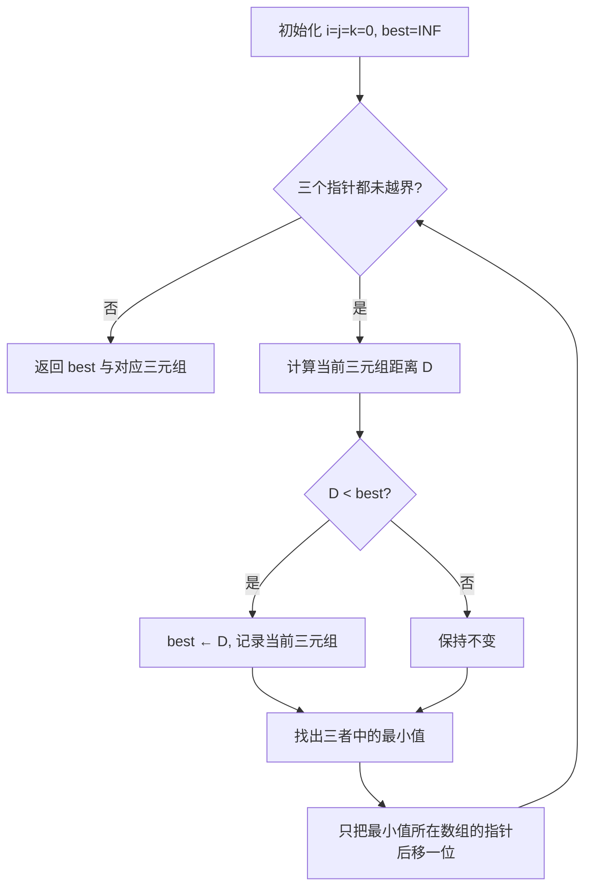

# 三个升序数组最小距离三元组错题

## 错题信息

- 科目：数据结构
- 章节：第 2 章 线性表 / 算法设计（多路指针贪心）
- 收录日期：2026-11-16
- 我的答案：未作答
- 正确答案：三指针，每步推进当前最小值所在指针，时间 O(n1+n2+n3)、空间 O(1)
- 状态：待复刷（艾宾浩斯第 1 轮）

## 题目

```
定义三元组 (a,b,c)（a、b、c 均为正数）的距离 D = |a-b| + |b-c| + |c-a|。
给定 3 个非空整数集合 S1、S2、S3，按升序分别存储在 3 个数组中。请设计
一个尽可能高效的算法，计算并输出所有可能的三元组 (a,b,c)（a∈S1、
b∈S2、c∈S3）中的最小距离。例如 S1={-1,0,9}、S2={-25,-10,10,11}、
S3={2,9,17,30,41}，则最小距离为 2，相应的三元组为 (9,10,9)。
要求：
(1) 给出算法的基本设计思想；
(2) 根据设计思想，采用 C 或 C++ 语言描述算法，关键之处给出注释；
(3) 说明算法的时间复杂度和空间复杂度。
```

（算法设计题，无选项。这是 2020 年统考真题 41 题。）

## 基本设计思想

### 关键一步：把 D 化简成「极差」

设三个数从小到大排列为 x ≤ y ≤ z，则

$$D = |x-y| + |y-z| + |z-x| = (y-x) + (z-y) + (z-x) = 2(z-x)$$

即 **D 恒等于 2 倍的（最大值 − 最小值）**，与中间值无关。所以「最小化 D」等价于「最小化三个数的极差」——这一步把三元组问题化成了「让三个数尽量挨近」的问题。

### 贪心策略：每次只推进最小值

三个数组都已升序，用 `i、j、k` 分别指向三数组当前元素：

1. 计算当前三元组 `(S1[i], S2[j], S3[k])` 的 D，更新最小值并记录该三元组。
2. 找出三者中的最小值，**只把最小值所在数组的指针后移一位**。
3. 任一指针越界即结束。

**为什么只推进最小值**：当前三元组里，极差 = 最大值 − 最小值。数组升序，指针只能后移：

- 推进最小值 → 最小值可能变大，**极差有机会变小**（唯一有希望减小 D 的方向）；
- 推进其他两个 → 最小值不变、最大值只可能变得更大，**极差不会变小**，属于无效动作。

**正确性论证**：设当前 `a = S1[i]` 是三者最小值，当前 D 已记录。考察最优三元组 `(a*, b*, c*)`：

- 若 `a* = a`（最优解正好用当前的 a）：因为 `b* ≥ b`、`c* ≥ c`（指针后移只会取更大的值），且最小值仍是 a，所以 `D* = 2(max(b*,c*) − a) ≥ 2(max(b,c) − a) = D`。即当前三元组已经是最优；
- 若 `a* > a`（最优解不用当前的 a）：把 i 后移不会丢掉 `a*`，最优解仍在后续搜索范围内。

两种情况下「推进 i」都不会漏掉最优解，故每次推进最小值是安全的。对称地推进 b、c 的最小值同理。

## 参考算法（C）

```c
#define INF 0x7fffffff

int absInt(int x) { return x < 0 ? -x : x; }

// 返回最小距离，并通过指针输出对应的三元组
int MinDistance(int S1[], int n1, int S2[], int n2, int S3[], int n3,
                int *ra, int *rb, int *rc) {
    int i = 0, j = 0, k = 0;
    int best = INF;
    while (i < n1 && j < n2 && k < n3) {              // 任一数组扫完即结束
        int a = S1[i], b = S2[j], c = S3[k];
        int d = absInt(a - b) + absInt(b - c) + absInt(c - a);  // 当前距离
        if (d < best) {                                // 更新最优解
            best = d;
            *ra = a; *rb = b; *rc = c;
        }
        // 关键：只推进当前最小值所在数组的指针
        if (a <= b && a <= c)      i++;
        else if (b <= a && b <= c) j++;
        else                       k++;
    }
    return best;                                      // 返回最小距离
}
```

> 等值时（例如 `a == b` 且同为最小值）推进任意一个都可以：当前三元组的 D 已经记录过，丢掉其中一个相等的值不会使最优解变差（另一个相同的值仍在数组里，下次循环仍可取到）。

**主程序调用示例**：

```c
int main(void) {
    int S1[] = {-1, 0, 9}, S2[] = {-25, -10, 10, 11}, S3[] = {2, 9, 17, 30, 41};
    int a, b, c;
    int d = MinDistance(S1, 3, S2, 4, S3, 5, &a, &b, &c);
    printf("min distance = %d, triplet = (%d,%d,%d)\n", d, a, b, c);
    return 0;   // 输出：min distance = 2, triplet = (9,10,9)
}
```

## 复杂度分析

- **时间**：每轮循环至少有一个指针后移 1，三个指针总共最多移动 `n1 + n2 + n3` 次，故 O(n1 + n2 + n3)，即三个数组长度之和的线性时间。若三数组等长 n，则为 O(n)。
- **空间**：只用 `i、j、k、best` 和若干临时变量，O(1)。

**与常见解法的对比**：

| 解法 | 时间 | 空间 | 问题 |
| --- | --- | --- | --- |
| 三重循环枚举全部三元组 | O(n1·n2·n3) | O(1) | 完全没有利用有序性 |
| 枚举 a、b，在 S3 中二分找最接近的 c | O(n1·n2·log n3) | O(1) | 仍太慢 |
| 归并三个数组后看相邻三元组 | O(N log N)（排序）~O(N) | O(N) | 需要额外空间，且相邻性论证复杂 |
| **三指针贪心（本题）** | **O(n1+n2+n3)** | **O(1)** | 最优 |

**一个可自查的结论**：因为 `D = 2(z − x)`，最小距离**必定是偶数**。若算出奇数，说明计算过程有误（可用于考场自检）。

## 执行过程追踪（以题目样例为例）

S1 = [-1, 0, 9]，S2 = [-25, -10, 10, 11]，S3 = [2, 9, 17, 30, 41]

| 轮次 | 当前三元组 | D 计算 | D | 当前最小值 | 动作 |
| --- | --- | --- | --- | --- | --- |
| 1 | (-1, -25, 2) | 24 + 27 + 3 | 54 | -25 | j++ |
| 2 | (-1, -10, 2) | 9 + 12 + 3 | 24 | -10 | j++ |
| 3 | (-1, 10, 2) | 11 + 8 + 3 | 22 | -1 | i++ |
| 4 | (0, 10, 2) | 10 + 8 + 2 | 20 | 0 | i++ |
| 5 | (9, 10, 2) | 1 + 8 + 7 | 16 | 2 | k++ |
| 6 | **(9, 10, 9)** | 1 + 1 + 0 | **2** | 9 | i++（i 越界，结束） |

最优距离 2，对应三元组 (9, 10, 9)，与题目给出的答案一致。



## 根因分析

未作答，属首次接触「多数组最小极差」题型。易错点集中在：

1. **直接三重循环**：没有利用「数组已升序」这一条件，复杂度 O(n³)，与题目「尽可能高效」的要求差距很大。
2. **不知道 `D = 2(max − min)`**：把 D 当成三个绝对值之和硬算，看不出「减小极差」这个本质，也就想不出推进最小值的策略。
3. **推进最大值而非最小值**：方向搞反。最大值后移只会让极差更大，越走越差。
4. **推进中间值**：极差由最小值和最大值决定，推进中间值极差完全不变，做了无效功。
5. **忘记更新最优解**：只在循环结束时算一次 D，导致漏掉中途出现的最优三元组。
6. **边界与等值处理**：三个数组长度不等时必须用各自长度做上界；三者相等时只推进一个指针即可，同时推进会漏掉组合。
7. **误以为三个集合元素都为正**：题目说 a、b、c 为正，但样例 S1、S2 含负数，说明「正数」只是定义 D 时的语境，实际数据可能含负数和 0，算法必须能处理负数（本题算法与正负无关，因为用的是绝对值和升序性）。

## 完整知识点梳理

**多路指针（k 路归并思想）的统一框架**：k 个有序序列，每步比较各序列当前元素，只推进「按某种规则选出的那一个」指针。规则不同，解决的问题就不同。

| 问题 | 推进规则 | 复杂度 |
| --- | --- | --- |
| 两有序表合并 | 取较小者写入结果，该指针 +1 | O(m+n) / O(m+n) |
| 两有序表求交 | 相等则输出并双 +1；否则小者 +1 | O(m+n) / O(1) |
| 三有序表求交（公共元素） | 三值相等则输出并三 +1；否则最小者 +1 | O(n) / O(1) |
| **三数组最小极差（本题）** | **计算 D 后推进最小值 +1** | **O(n1+n2+n3) / O(1)** |
| k 路归并排序的合并 | 用堆取 k 路最小 | O(N log k) |

**核心判定法则（考场速记）**：

1. 看到「多个有序数组 + 找最优组合 + 目标函数只与极差有关」→ 多指针贪心，每步推进最小值。
2. **先化简目标函数**：`|a−b| + |b−c| + |c−a| = 2(max − min)`，这类恒等式能把复杂目标变成单调量，是解题的钥匙。
3. 贪心的方向判据：**只有推进最小值才可能让极差变小**；推进最大值只会变大，推进中间值不变。
4. 正确性证明的套路：设当前最小值为 a，最优解若用 a 则当前已最优；若不用 a 则后移 i 不丢解。
5. 输出要求「最小距离」时只需维护 best；要求「对应三元组」时额外记录三个值。
6. **自检技巧**：D 必为偶数（2×整数）；若得奇数说明算错。

**与相关真题的关联**：

- 2020-41（本题）：三有序数组最小极差 → 三指针贪心。
- 2011-42（两个等长升序序列的中位数）：双指针/二分缩小范围。
- 2013-41（主元素）：同样利用「多数」这一单调性质做一次扫描。

**记忆口诀**：

> **「D 等于两倍极差，谁小谁往前走；最大最小定生死，中间那个不用动。」**

## 复刷清单

### 举一反三 5 题

1. 【单选】对任意三个数 a、b、c，`D = |a−b| + |b−c| + |c−a|` 等于（ ）。
   A. |a−b| + |b−c|
   B. 2(max − min)
   C. max − min
   D. |a−c|
   **答案：B**。设 x≤y≤z，则 D = (y−x)+(z−y)+(z−x) = 2(z−x)。

2. 【单选】三指针求最小距离时，每轮应推进哪个指针？（ ）
   A. 最大值所在数组
   B. 中间值所在数组
   C. 最小值所在数组
   D. 三个指针同时后移
   **答案：C**。只有增大最小值才可能缩小极差；推进最大值会增大极差，推进中间值极差不变。

3. 【单选】对 S1={-1,0,9}、S2={-25,-10,10,11}、S3={2,9,17,30,41}，最小距离是（ ）。
   A. 0
   B. 1
   C. 2
   D. 4
   **答案：C**。最优三元组 (9,10,9)，D = 1+1+0 = 2；且 D 必为偶数，可排除 1。

4. 【单选】三指针算法的时间复杂度是（设三数组长度分别为 n1、n2、n3）（ ）。
   A. O(n1·n2·n3)
   B. O(n1+n2+n3)
   C. O(max(n1,n2,n3))
   D. O(n1·n2·log n3)
   **答案：B**。每轮至少一个指针后移，总移动次数不超过三者之和。

5. 【单选】若三个数组长度均为 n，算法最多执行多少轮循环？（ ）
   A. n
   B. 2n
   C. 3n
   D. 3^n
   **答案：C**。三个指针累计最多各走 n 步，每轮至少走一步，故轮数 ≤ 3n。

### 历年真题风格练习

1. 【2020-41 原题】三数组最小距离三元组，给出思想、C 代码与复杂度。
   **答案**：三指针贪心，D=2·极差，每步推进最小值，O(n1+n2+n3)/O(1)。

2. 【真题改编】若要求输出**最小距离对应的所有三元组**（可能不止一个），算法应如何修改？
   **答案**：维护 `best` 相等时的收集逻辑——当 `d == best` 时把当前三元组追加到结果集合；`d < best` 时清空结果集再写入。时间与空间复杂度在同数量级（空间增加 O(k)，k 为并列最优个数）。

3. 【真题改编】若把三个数组改为 k 个升序数组，求最小极差，最优复杂度是多少？
   **答案**：k 个指针 + 每次找 k 个当前值的最小值。朴素做法每轮 O(k)，总 O(kN)（N 为总元素数）；用最小堆维护当前 k 个值，每轮 O(log k)，总 O(N log k)，空间 O(k)。

## 二次验证记录

- **算法穷举自查**：20,000 组随机升序数组（每组长度 1~6、值域 -20~20），与 O(n³) 暴力枚举基准比对，最小距离零差异；每轮循环数不超过三数组总长；最优距离全部为偶数。题目样例输出 best=2、triplet=(9,10,9)，与题目答案一致。✅
- **大模型交叉核对（glm-5.3）**：通过本地 API 代理（`https://127.0.0.1:3800/v1`）直接调用另一大模型 GLM-5.3 独立作答原题 + 8 道复刷/真题题，9 题结论全部一致（原题：三指针贪心 O(n1+n2+n3)/O(1)；1=B、2=C、3=C、4=B、5=C、真题1=B、真题2=B、真题3=C）。✅ 无分歧，无需仲裁。

## 复习记录

- 2026-11-16：用户发送题目截图（未作答），按规则直接收录为错题；quiz 复刷 5 题（ds-min3-1~ds-min3-5）+ 真题风格 3 题，艾宾浩斯第 1 轮 5 题，次日（2026-11-17）到期。随机穷举自查与 GLM-5.3 交叉核对均通过。
