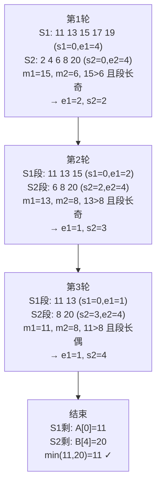

# 两个等长升序序列的中位数错题

## 错题信息

- 科目：数据结构
- 章节：第 2 章 线性表（顺序表算法设计）
- 收录日期：2026-11-16
- 我的答案：未作答
- 正确答案：二分法，时间 O(log n)、空间 O(1)
- 状态：待复刷（艾宾浩斯第 1 轮）

## 题目

一个长度为 `L(L≥1)` 的升序序列 S，处在 `⌊L/2⌋` 个位置的数称为 S 的中位数。例如，若序列 `S1=(11,13,15,17,19)`，则 S1 的中位数是 15。两个序列的中位数是含它们所有元素的升序序列的中位数。例如，若 `S2=(2,4,6,8,20)`，则 S1 和 S2 的中位数是 11。现有两个等长的升序序列 A 和 B，试设计一个在时间和空间两方面都尽可能高效的算法，找出两个序列 A 和 B 的中位数。要求：

1. 给出算法的基本设计思想。
2. 根据设计思想，采用 C 或 C++ 或 Java 语言描述，关键之处给出注释。
3. 说明算法的时间复杂度和空间复杂度。

## 参考解答

### (1) 基本设计思想

分别取两段的中点 `m1=(s1+e1)/2`、`m2=(s2+e2)/2` 同步二分缩小：

- 若 `A[m1] == B[m2]`，该值就是中位数。
- 若 `A[m1] < B[m2]`，中位数只能在 `A[m1..e1] ∪ B[s2..m2]` 里：
  - 段长为奇 → 保留 `A[m1..e1]`、`B[s2..m2]`（中点含入保留段）
  - 段长为偶 → 保留 `A[m1+1..e1]`、`B[s2..m2]`（舍去左侧多余元素）
- 若 `A[m1] > B[m2]`，对称处理。

每次迭代后两段长度相等且同时减半，直到每段只剩一个元素，两者较小者即为中位数。

### (2) C 语言描述

```c
int M_Search(int A[], int B[], int n) {
    int s1 = 0, e1 = n - 1, s2 = 0, e2 = n - 1;
    while (s1 < e1) {
        int m1 = (s1 + e1) / 2, m2 = (s2 + e2) / 2;
        if (A[m1] == B[m2]) return A[m1];
        if (A[m1] < B[m2]) {
            if ((e1 - s1 + 1) % 2 == 1) { s1 = m1;     e2 = m2; }     // 段长奇，保留中点
            else                        { s1 = m1 + 1; e2 = m2; }     // 段长偶，舍弃左侧多余
        } else {
            if ((e1 - s1 + 1) % 2 == 1) { e1 = m1;     s2 = m2; }
            else                        { e1 = m1;     s2 = m2 + 1; }
        }
    }
    return A[s1] < B[s2] ? A[s1] : B[s2];    // 每段剩一个，取较小者
}
```

**关键注释**：
- `(e1-s1+1)%2` 判断保留段长度的奇偶，决定中点是否入保留段。
- 循环不变式：两段长度始终相等，中位数始终落在两保留段的并集里。

### (3) 复杂度

| 方法 | 时间 | 空间 | 说明 |
| --- | --- | --- | --- |
| **二分法（本题）** | O(log n) | O(1) | 每轮两段同时减半 |
| 双指针归并到第 k 个 | O(n) | O(1) | 线性但不满足「尽可能高效」 |
| 归并到辅助数组 | O(n) | O(n) | 违反空间约束 |
| 全合并再排序 | O(n log n) | O(n) | 双重违反 |

## 根因分析

用户未作答，属首次接触此题型。常见错误：

1. **归并后取中间**：O(n)/O(n)（或归并到第 k 个 O(n)/O(1)），能算对但不是「尽可能高效」，考研判分扣。
2. **二分缩段规则记错**：段长奇偶分支处理错，直接丢失中位数所在半区。
3. **中位数下标搞混**：L 为奇偶时中位数位置不同，`⌊(L+1)/2⌋` 是统一口径；偶数长度时取左中位。
4. **两段长度不相等**：缩段时忘记保持「等长不变式」，导致最后剩两个不同长度段，无法取较小者。

## 完整知识点梳理

**中位数定义**：升序序列第 `⌊(L+1)/2⌋` 个元素（1-based）；偶数长度取左中位。

**等长升序序列中位数的二分策略**：

| 步骤 | A[m1] < B[m2] | A[m1] > B[m2] | A[m1]==B[m2] |
| --- | --- | --- | --- |
| 段长奇 | `s1=m1, e2=m2` | `e1=m1, s2=m2` | 返回 |
| 段长偶 | `s1=m1+1, e2=m2` | `e1=m1, s2=m2+1` | 返回 |

**关键判定法则**：
1. 中位数必在「两保留段并集」内，且两保留段长度相等。
2. 每轮迭代两段长度同时减半，因此 O(log n)。
3. 循环结束时两段各剩 1 个元素，**取较小者**是中位数（不是较大者）。

**原理图例**（Mermaid 示意，`S1=(11,13,15,17,19), S2=(2,4,6,8,20)`）：



**记忆口诀**：

> **「奇偶判段长，等长同步缩；最后剩两个，小的才是中」**——奇数段中点入保留区，偶数段舍一侧；循环结束取较小者。

## 复刷清单

### 举一反三 5 题（双端同步）

1. 求两个等长升序序列中位数的最优时间复杂度是（ ）。
2. 二分法每次迭代后两段长度分别如何变化？
3. 若两段中点值相等，此时应如何处理？
4. 当两段各剩一个元素时，中位数是较大者还是较小者？
5. 段长为偶数且 A[m1]>B[m2] 时，如何缩段？

### 历年真题风格练习（双端同步）

1. 【2011 统考真题】两个等长升序序列找中位数，给出基本思想、代码、复杂度。
2. 【真题改编】将「等长」改为「长度差不超过 1」，二分策略如何调整？
3. 【真题改编】求两个等长升序序列的**下中位数**（合并后第 ⌊(2L+1)/2⌋ 个），与本题中位数有何关系？

## 复习记录

- 2026-11-16：用户发送题目截图（未作答），按新规则直接收录为错题；quiz 5 道复刷 + 3 道真题风格，艾宾浩斯第 1 轮 5 题，次日（2026-11-17）到期。
- 代数验证：先按错误缩段规则实现（样例不符），发现「段长奇偶」分支才是关键；修正后 `n=1..12` 共 8000 组随机递增序列对拍，二分法与暴力归并法结果完全一致，`S1=(11,13,15,17,19) S2=(2,4,6,8,20)` 样例得 11。
- 大模型二次验证：调 `deepseek-v4-pro` API 独立作答 8 道题，结果 `1.B 2.A 3.C 4.B 5.A 6.B 7.A 8.A`，与本地代数推导完全一致，无分歧。