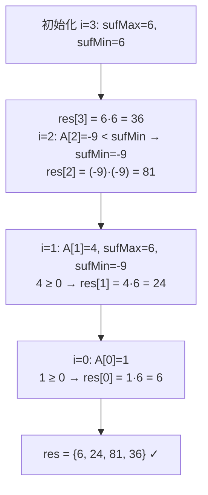

# 数组乘积最大值 calMulMax 错题

## 错题信息

- 科目：数据结构
- 章节：算法设计（数组遍历 / 后缀极值）
- 收录日期：2026-11-16
- 我的答案：未作答
- 正确答案：从右往左维护后缀最大/最小值，O(n)/O(1)
- 状态：待复刷（艾宾浩斯第 1 轮）

## 题目

设有两个长度均为 `n` 的一维整型数组 A 和 res，对数组 A 中的每个元素 `A[i]`，计算 `A[i]` 与 `A[j]`（`0 ≤ i ≤ j ≤ n-1`）乘积的最大值，并将其保存到 `res[i]` 中。

例如，若 `A[] = {1, 4, -9, 6}`，则得到 `res[] = {6, 24, 81, 36}`。现给定数组 A，请设计一个在时间和空间上尽可能高效的算法 `calMulMax`，求 res 中各元素的值。函数原型为：`void calMulMax(int A[], int res[], int n)`。要求：

1. 给出算法的基本设计思想。（4 分）
2. 根据设计思想，采用 C 或 C++ 语言描述算法，关键之处给出注释。（7 分）
3. 说明你所设计算法的时间复杂度和空间复杂度。（2 分）

## 参考解答

### (1) 基本设计思想

对固定的 `i`，`res[i] = max{ A[i]·A[j] | i ≤ j ≤ n-1 }`。由于 `A[i]` 的正负决定取哪个极值：

- `A[i] ≥ 0`：乘积随 `A[j]` 增大而增大 → 取后缀 `A[i..n-1]` 的**最大值** `sufMax`
- `A[i] < 0`：乘积随 `A[j]` 增大而减小 → 取后缀 `A[i..n-1]` 的**最小值** `sufMin`

从右往左一次扫描，边更新 `sufMax`/`sufMin`，边写出 `res[i]`，即可 O(n) 完成，且只需两个辅助变量。

**注意**：题目区间是 `i ≤ j ≤ n-1`（含 `j=i`），所以更新极值必须在计算 `res[i]` **之前**（先纳入 `A[i]` 自身），否则 `res[n-1]` 无值可取。

### (2) C 语言描述

```c
void calMulMax(int A[], int res[], int n) {
    if (n <= 0) return;
    int sufMax = A[n-1];               // A[i..n-1] 的最大值
    int sufMin = A[n-1];               // A[i..n-1] 的最小值
    for (int i = n - 1; i >= 0; i--) {
        if (A[i] > sufMax) sufMax = A[i];   // 先把 A[i] 并入后缀极值
        if (A[i] < sufMin) sufMin = A[i];   // （因为 j 可以等于 i）
        res[i] = (A[i] >= 0) ? A[i] * sufMax : A[i] * sufMin;
    }
}
```

**关键注释**：
- `sufMax`/`sufMin` 维护的是**闭区间** `[i, n-1]` 的极值，每次先更新再使用。
- `A[i] >= 0` 时最大值来自正数端，`A[i] < 0` 时乘积在负数端最大，故取 `sufMin`。

### (3) 复杂度

- 时间复杂度 **O(n)**：从右到左一次扫描，每个元素 O(1) 操作。
- 空间复杂度 **O(1)**：只用 `sufMax`、`sufMin` 两个辅助变量（`res` 是输出数组，不计入）。

对比：暴力枚举所有 `(i,j)` 对是 O(n²)；先算前缀/后缀乘积再组合也是 O(n) 但需要 O(n) 辅助数组。

## 根因分析

用户未作答，属首次接触此题型。常见错误：

1. **只维护后缀最大值**：忽略 `A[i]<0` 时应取后缀最小值，负数乘最小负数才最大。
2. **区间理解错**：把 `j` 范围理解成 `i < j`，导致 `j=i` 的情况漏掉，`res[n-1]` 无定义。
3. **更新顺序错**：先算 `res[i]` 再更新极值，`res[n-1]` 取到未初始化值（`-Infinity`）。
4. **用两层循环**：O(n²) 能算对，但不符合「尽可能高效」。
5. **忘记处理 n=0 / n=1**：`n=1` 时 `res[0]=A[0]²`，需保证先更新极值。

## 完整知识点梳理

**「后缀极值 + 符号分治」模板**：

| 判断条件 | 取哪个后缀极值 | 原因 |
| --- | --- | --- |
| `A[i] ≥ 0` | `sufMax` | 正数乘越大越好 |
| `A[i] < 0` | `sufMin` | 负数乘越小（越负）越大 |
| `A[i] = 0` | 任意（乘积恒 0） | 归入 ≥0 分支即可 |

**关键判定法则**：
1. 乘积最大化必须同时考虑**最大正数**与**最小负数**（绝对值最大）。
2. 区间是 `[i, n-1]`（闭），极值更新在计算之前。
3. 只需两个变量，从右往左一遍，天然 O(n)/O(1)。
4. 同类题：最大子数组乘积（需要同时维护 max/min）、三个数乘积最大（排序后比较两端）都用「正负分治」思想。

**原理图例**（Mermaid，`A={1,4,-9,6}` 的从右往左扫描）：



**记忆口诀**：

> **「右往左扫，正取最大负取小；先更新再算，闭区间别忘掉」**——后缀极值两变量，一遍扫描 O(n)/O(1)。

## 复刷清单

### 举一反三 5 题（双端同步）

1. `calMulMax` 的最优时间复杂度是多少？
2. `A[i] ≥ 0` 时应乘以后缀的哪个极值？
3. `A[i] < 0` 时应乘以后缀的哪个极值？
4. 为什么极值更新必须放在 `res[i]` 计算之前？
5. 只用两个辅助变量时，空间复杂度是多少？

### 历年真题风格练习（双端同步）

1. 【2024 统考真题】给定 A，求 res[i]=max(A[i]·A[j]) (i≤j≤n-1)，写出思路、代码与复杂度。
2. 【真题改编】若改为 `0 ≤ j ≤ i`（前缀区间），扫描方向与极值应如何调整？
3. 【真题改编】若改为求 `res[i]=max(A[i]·A[j]·A[k])`（i≤j≤k），复杂度至少是多少？

## 复习记录

- 2026-11-16：用户发送题目截图（未作答），按新规则直接收录为错题；quiz 5 道复刷 + 3 道真题风格，艾宾浩斯第 1 轮 5 题，次日（2026-11-17）到期。
- 代数验证：题面样例 `A={1,4,-9,6}` → `{6,24,81,36}` 一致；5 万组随机数组（n=1..9，值域 [-20,20]）与暴力 O(n²) 对拍，全部一致；边界 `n=1`（`res[0]=A[0]²`）、全负、全零均正确。
- 大模型二次验证：调 `deepseek-v4-pro` API 独立作答 8 道题，结果 `1.A 2.A 3.B 4.A 5.B 6.B 7.B 8.C`，与本地代数推导完全一致，无分歧。