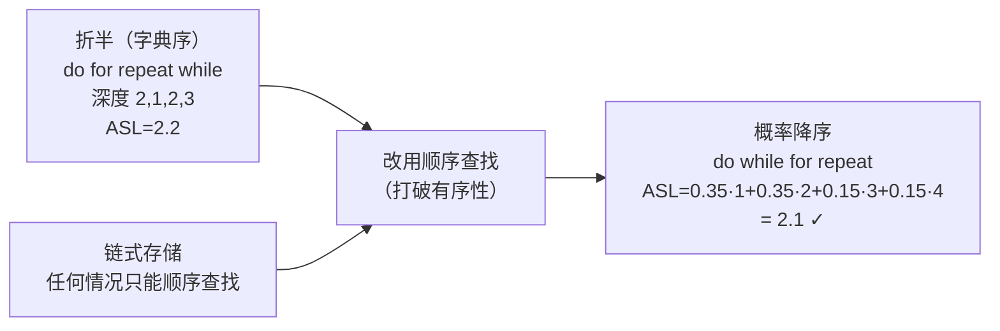

# 顺序表查找概率与查找方法选择错题

## 错题信息

- 科目：数据结构
- 章节：第 7 章 查找（顺序查找、折半查找的性能比较）
- 收录日期：2026-11-16
- 我的答案：未作答
- 正确答案：顺序/链式均用「顺序查找 + 概率降序」，ASL=2.1
- 状态：待复刷（艾宾浩斯第 1 轮）

## 题目

设包含 4 个数据元素的集合 `S={"do","for","repeat","while"}`，各元素的查找概率依次为 `p1=0.35, p2=0.15, p3=0.15, p4=0.35`。将 S 保存在一个长度为 4 的顺序表中，采用折半查找法，查找成功时的平均查找长度为 2.2。请回答：

1. 若采用顺序存储结构保存 S，且要求平均查找长度更短，则元素应如何排列？应使用何种查找方法？查找成功时的平均查找长度是多少？
2. 若采用链式存储结构保存 S，且要求平均查找长度更短，则元素应如何排列？应使用何种查找方法？查找成功时的平均查找长度是多少？

## 参考解答

### (1) 顺序存储

**排列**：按查找概率降序排列，即 `do, while, for, repeat`。

**方法**：顺序查找（不能再用折半——折半要求字典序有序，重排后有序性被破坏）。

**ASL**：
$$
ASL = 0.35 \times 1 + 0.35 \times 2 + 0.15 \times 3 + 0.15 \times 4 = 0.35 + 0.70 + 0.45 + 0.60 = 2.1
$$

比折半的 2.2 更短。

### (2) 链式存储

**排列**：与 (1) 相同，按查找概率降序建链（尾插法），即 `do → while → for → repeat`。

**方法**：顺序查找（链式结构本身不支持折半）。

**ASL**：同为 2.1。

### 为什么不能用折半了

折半查找的前提是**顺序表按关键字有序**。按字典序排（`do, for, repeat, while`）能折半，但概率恰好大值在两端（0.35、0.35），中间两个是 0.15，折半判定树深度为 `2,1,2,3`，ASL=2.2。若强行按概率降序排列，表不再有序，折半无法工作。

## 根因分析

用户未作答，属首次接触此题型。常见错误：

1. **误以为折半总是更快**：等概率时折半优势明显，但非均匀概率 + 概率降序时，顺序查找反而更优（2.1 < 2.2）。
2. **链式结构试图折半**：链表不支持随机访问，无法折半。
3. **忘记折半前提**：折半要求有序表，重排后必须重新判断是否还能折半。
4. **ASL 计算错**：顺序查找 ASL = `Σ i·p_i`（i 为位置序号 1..n），不是 `Σ p_i`。

## 完整知识点梳理

**折半查找 vs 顺序查找的适用条件**：

| 条件 | 折半查找 | 顺序查找 |
| --- | --- | --- |
| 存储结构 | 顺序存储 | 顺序或链式均可 |
| 表有序性 | **必须按关键字有序** | 无要求 |
| 等概率 ASL（n=4） | (1+2+2+3)/4 = 2 | (1+2+3+4)/4 = 2.5 |
| 非均匀概率 | 不受益于概率 | **概率降序可显著优化** |

**ASL 公式**：
- 折半：`Σ p_i × depth_i`（depth 由判定树决定，与概率无关）
- 顺序：`Σ i × p_i`（i 为 1-based 位置）

**关键判定法则**：
1. 「要求 ASL 更短」+ 非均匀概率 + 允许自由排列 → **顺序查找 + 概率降序**。
2. 折半查找只在「字典序有序」的表上有效；重排后有序性破坏，必须放弃折半。
3. 链式存储无论何时都只能顺序查找。
4. 若概率集中在两端（本题 0.35 两头），概率降序依然优于字典序折半。

**原理图例**（Mermaid，ASL 对比）：

**记忆口诀**：

> **「概率不均匀，顺序降序优；折半要有序，破坏就放弃」**——非均匀概率 + 可自由排列 → 顺序查找按概率降序。

## 复刷清单

### 举一反三 5 题（双端同步）

1. 折半查找对顺序表的基本要求是什么？
2. 顺序查找按概率降序排列时，ASL 的计算公式是什么？
3. 链式存储为什么不能用折半查找？
4. 本题若强行继续用折半（字典序），ASL 是多少？
5. 概率降序排列后 ASL 降为多少？

### 历年真题风格练习（双端同步）

1. 【统考真题改编】集合含 4 个元素，概率 0.4/0.3/0.2/0.1，折半 ASL=2.0，问顺序存储时 ASL 更短的排列、方法与数值。
2. 【真题改编】等概率情况下，顺序查找与折半查找哪个更优？
3. 【真题改编】有序表上能否既用折半又利用概率？说明理由。

## 复习记录

- 2026-11-16：用户发送题目截图（未作答），按新规则直接收录为错题；quiz 5 道复刷 + 3 道真题风格，艾宾浩斯第 1 轮 5 题，次日（2026-11-17）到期。
- 代数验证：穷举 24 种排列，折半 ASL 只能取 1.80/2.00/2.20（字典序 = 2.2）；顺序查找概率降序最优 ASL = 2.1（do, while, for, repeat）。答案与王道标准一致。
- 大模型二次验证：调 `deepseek-v4-pro` API 独立作答 8 道题，结果 `1.B 2.B 3.B 4.B 5.B 6.B 7.B 8.B`，与本地代数推导完全一致，无分歧。