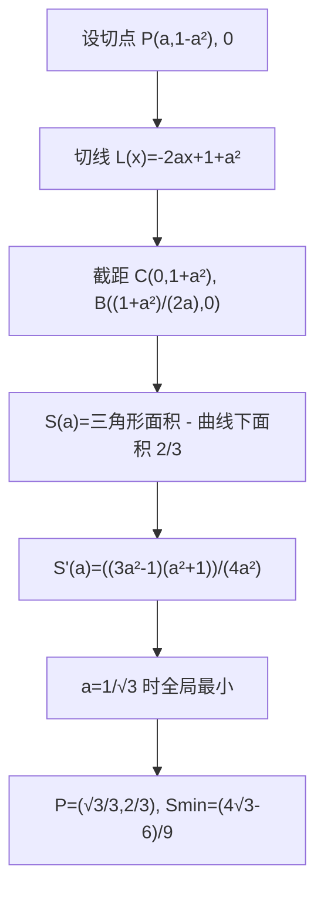

# 切线与抛物线及坐标轴围成图形面积最小错题

## 错题信息

- 科目：高等数学
- 知识点：切线方程、平面图形面积、导数求最值
- 题目来源：错题截图
- 我的答案：未作答
- 正确答案：切点为 $P\left(\dfrac{\sqrt3}{3},\dfrac23\right)$，最小面积为 $S_{\min}=\dfrac{4\sqrt3-6}{9}$

## 题目

在第一象限内求曲线 $y=-x^{2}+1$ 上的一点，使该点处的切线与所给曲线及两坐标轴所围成的图形面积最小，并求此最小面积。

## 正确解答

设第一象限内的切点为

$$P(a,1-a^{2}),\qquad 0<a<1.$$

曲线导数为 $y'=-2x$，所以切线斜率为 $-2a$，切线方程为

$$y-(1-a^{2})=-2a(x-a),$$

即

$$L(x)=-2ax+1+a^{2}.$$

切线与 $y$ 轴、$x$ 轴的交点分别为

$$C(0,1+a^{2}),\qquad B\left(\frac{1+a^{2}}{2a},0\right).$$

因为曲线是开口向下的抛物线，切线在曲线上方，并且

$$L(x)-f(x)=(-2ax+1+a^{2})-(-x^{2}+1)=(x-a)^{2}\ge 0.$$

两坐标轴、切线和曲线所围成的阴影图形，等于大三角形 $\triangle OCB$ 减去曲线与两坐标轴围成的固定曲边三角形。后者面积为

$$\int_{0}^{1}(1-x^{2})\,\mathrm{d}x=1-\frac13=\frac23.$$

因此面积函数为

$$S(a)=\frac12(1+a^{2})\cdot\frac{1+a^{2}}{2a}-\frac23
=\frac{(1+a^{2})^{2}}{4a}-\frac23.$$

展开并求导：

$$S(a)=\frac14\left(a^{3}+2a+\frac1a\right)-\frac23,$$

$$S'(a)=\frac14\left(3a^{2}+2-\frac1{a^{2}}\right)
=\frac{(3a^{2}-1)(a^{2}+1)}{4a^{2}}.$$

由于 $a>0$ 且 $a^{2}+1>0$，$S'(a)$ 的符号只由 $3a^{2}-1$ 决定：

- 当 $0<a<\dfrac1{\sqrt3}$ 时，$S'(a)<0$；
- 当 $\dfrac1{\sqrt3}<a<1$ 时，$S'(a)>0$。

所以 $a=\dfrac1{\sqrt3}$ 是区间 $(0,1)$ 内唯一的极小点，也是全局最小点。此时

$$P\left(\frac1{\sqrt3},1-\frac13\right)
=\left(\frac{\sqrt3}{3},\frac23\right).$$

最小面积为

$$
\begin{aligned}
S_{\min}
&=\frac{\left(1+\frac13\right)^{2}}{4\cdot\frac1{\sqrt3}}-\frac23\
&=\frac{4\sqrt3}{9}-\frac23
=\frac{4\sqrt3-6}{9}.
\end{aligned}
$$

数值上 $S_{\min}\approx 0.1031336923$。

## 根因分析

本题未作答，按该题型的典型易错点归纳如下：

1. **切线常数项写错**：由点斜式化简后常数项是 $1+a^{2}$，不是 $1-a^{2}$。漏掉 $2a^{2}$ 会直接导致两个截距都错。
2. **图形边界识别错**：题目说的是切线、曲线和两坐标轴共同围成的图形。它不是切线与曲线在切点附近的小块面积，而是切线截出的三角形减去曲线在 $[0,1]$ 上与坐标轴围成的固定面积 $\dfrac23$。
3. **忘减固定面积**：只最小化三角形面积会得到 $T_{\min}=\dfrac{4\sqrt3}{9}$，但题目所求面积还要减去 $\dfrac23$。
4. **极值方程符号错**：$S'(a)=\dfrac{(3a^{2}-1)(a^{2}+1)}{4a^{2}}$，正根只有 $a=\dfrac1{\sqrt3}$；若把 $3a^{4}+2a^{2}-1=0$ 分解错，容易误取 $a=1$。
5. **切点纵坐标代错**：$y=1-a^{2}$，当 $a^{2}=\dfrac13$ 时纵坐标是 $\dfrac23$，不是 $\dfrac13$。

## 完整知识点梳理

### 一、抛物线切线的统一形式

对 $y=c-x^{2}$（$c>0$），第一象限切点为 $P(a,c-a^{2})$，其中 $0<a<\sqrt c$。切线为

$$L(x)=-2ax+c+a^{2}.$$

它与两坐标轴的截距分别为

$$y_C=c+a^{2},\qquad x_B=\frac{c+a^{2}}{2a}.$$

切点处相切但不穿过曲线，因为

$$L(x)-(c-x^{2})=(x-a)^{2}\ge0.$$

### 二、面积差模型

曲线 $y=c-x^{2}$ 与两坐标轴围成的面积为

$$Q=\int_{0}^{\sqrt c}(c-x^{2})\,\mathrm{d}x=\frac{2}{3}c^{3/2}.$$

切线截出的三角形面积为

$$T(a)=\frac12(c+a^{2})\cdot\frac{c+a^{2}}{2a}
=\frac{(c+a^{2})^{2}}{4a}.$$

所求面积为

$$S(a)=T(a)-Q
=\frac{(c+a^{2})^{2}}{4a}-\frac{2}{3}c^{3/2}.$$

因为 $Q$ 与 $a$ 无关，所以最小化 $S(a)$ 等价于最小化 $T(a)$。本题中 $c=1$。

### 三、求导求最值

对一般形式：

$$T'(a)=\frac{3a^{4}+2ca^{2}-c^{2}}{4a^{2}}
=\frac{(3a^{2}-c)(a^{2}+c)}{4a^{2}}.$$

所以唯一正驻点为

$$a=\sqrt{\frac c3}.$$

由于 $a\to0^{+}$ 时 $T\to+\infty$，且导数在该点左负右正，此点取得全局最小。一般结论为

$$S_{\min}=\frac{(4\sqrt3-6)c^{3/2}}{9}.$$

本题 $c=1$ 时即为 $a=\dfrac{\sqrt3}{3}$、$S_{\min}=\dfrac{4\sqrt3-6}{9}$。

### 四、二维示意图（面积区域）

```svg
<svg viewBox="0 0 900 520" xmlns="http://www.w3.org/2000/svg" font-family="system-ui,sans-serif">
  <defs>
    <pattern id="hatch" width="10" height="10" patternTransform="rotate(45)" patternUnits="userSpaceOnUse">
      <line x1="0" y1="0" x2="0" y2="10" stroke="#f59e0b" stroke-width="2" opacity="0.42"/>
    </pattern>
  </defs>
  <line x1="90" y1="430" x2="850" y2="430" stroke="#94a3b8" stroke-width="1.8"/>
  <polygon points="850,430 838,423 838,437" fill="#94a3b8"/>
  <line x1="140" y1="470" x2="140" y2="50" stroke="#94a3b8" stroke-width="1.8"/>
  <polygon points="140,50 134,62 146,62" fill="#94a3b8"/>
  <text x="860" y="436" fill="#94a3b8" font-size="17">x</text>
  <text x="112" y="44" fill="#94a3b8" font-size="17">y</text>
  <text x="122" y="448" fill="#94a3b8" font-size="14">O</text>
  
  <path d="M 140 200 L 660 430 L 450 430 C 450 330, 320 200, 140 200 Z" fill="url(#hatch)" stroke="#f59e0b" stroke-width="2"/>
  <path d="M 140 200 C 240 200.0, 340 256.3, 450 430" fill="none" stroke="#3b82f6" stroke-width="3"/>
  <path d="M 140 200 L 660 430" fill="none" stroke="#f472b6" stroke-width="3"/>
  <line x1="140" y1="200" x2="450" y2="200" stroke="#64748b" stroke-width="1" stroke-dasharray="5 4"/>
  <line x1="655" y1="200" x2="655" y2="430" stroke="#64748b" stroke-width="1" stroke-dasharray="5 4"/>
  <line x1="450" y1="200" x2="450" y2="430" stroke="#64748b" stroke-width="1" stroke-dasharray="5 4"/>
  <circle cx="290" cy="255" r="6" fill="#22c55e"/>
  <text x="302" y="245" fill="#22c55e" font-size="15" font-weight="700">P(√3/3, 2/3)</text>
  <circle cx="450" cy="430" r="5" fill="#3b82f6"/>
  <text x="420" y="480" fill="#3b82f6" font-size="14">D(1,0)</text>
  <circle cx="140" cy="200" r="5" fill="#3b82f6"/>
  <text x="152" y="375" fill="#3b82f6" font-size="14">C(0,4/3)</text>
  <circle cx="660" cy="430" r="5" fill="#f472b6"/>
  <text x="695" y="370" fill="#f472b6" font-size="14">B(2√3/3,0)</text>
  <text x="205" y="225" fill="#3b82f6" font-size="15" font-weight="700">曲线 y=1-x²</text>
  <text x="590" y="285" fill="#f472b6" font-size="15" font-weight="700">切线 L(x)</text>
  <text x="610" y="355" fill="#b45309" font-size="16" font-weight="700">所求面积</text>
  <text x="450" y="510" fill="#334155" font-size="15" text-anchor="middle" font-weight="700">S = 三角形 OCB 面积 − 曲边三角形 OCD 面积（后者为 2/3）</text>
</svg>
```

### 五、思路图例（Mermaid）



### 六、 algebraic 验证（非近似推断）

由求导结果可直接写成平方差形式：

$$S(a)-S_{\min}
=\frac{(1+a^{2})^{2}}{4a}-\frac{4\sqrt3}{9}
=\frac{\left(a-\frac1{\sqrt3}\right)^{2}\left(a^{2}+\frac{2a}{\sqrt3}+3\right)}{4a}.$$

当 $a>0$ 时，右侧第二个因式恒正，因此 $S(a)\ge S_{\min}$，且等号仅在 $a=\dfrac1{\sqrt3}$ 时成立。这是不依赖导数单调性的严格代数验证。

## 考研速记规律（一看就会）

### 规律 1：抛物线切线先背统一模板

$y=c-x^{2}$ 在 $x=a$ 处的切线：

$$L(x)=-2ax+c+a^{2}.$$

常数项一定是 $c+a^{2}$：点斜式里的 $+2a^{2}$ 与原函数常数 $-a^{2}$ 合并。看到 $c-a^{2}+2a^{2}$，立刻写成 $c+a^{2}$。

### 规律 2：凹曲线在切点处“切线在上”

对 $y=c-x^{2}$：

$$L(x)-f(x)=(x-a)^{2}\ge0.$$

所以切线截出的三角形一定包住曲线与坐标轴围成的区域。面积题只要识别成“大三角形减固定曲边面积”，不要去找所谓切线与曲线之间的小区域。

### 规律 3：先减定值，再求最值

曲线部分面积 $Q=\dfrac23c^{3/2}$ 与切点 $a$ 无关，因此

$$\min S=\min T-Q.$$

导数为零时只需对三角形面积 $T(a)=\dfrac{(c+a^{2})^{2}}{4a}$ 求导，别把固定项 $Q$ 的导数写错。

### 规律 4：因式分解一眼看正负

$$T'(a)\propto 3a^{4}+2ca^{2}-c^{2}=(3a^{2}-c)(a^{2}+c).$$

只有 $3a^{2}-c=0$ 给出正根，所以 $a=\sqrt{c/3}$。另一因式 $a^{2}+c>0$ 永远不会给实根。

### 规律 5：两个截距都大于曲线截距

$y$-截距 $c+a^{2}>c$，$x$-截距 $\dfrac{c+a^{2}}{2a}\ge\sqrt c$（等号在 $a=\sqrt c$，即边界处）。因此最优 $a=\sqrt{c/3}$ 时，截距分别为 $\dfrac{4c}{3}$ 与 $\dfrac{2\sqrt{3c}}{3}$，可快速检查图形是否合理。

### 规律 6：三个高频陷阱

| 陷阱 | 错误做法 | 正确做法 |
| --- | --- | --- |
| 切线常数项 | 写成 $1-a^{2}$ | 化简为 $1+a^{2}$ |
| 面积对象 | 只算切线与曲线之间面积 | 三角形面积减 $\dfrac23$ |
| 最优纵坐标 | 把 $1-a^{2}$ 算成 $\dfrac13$ | $a^{2}=\dfrac13$ 时 $y=\dfrac23$ |

### 规律 7：30 秒流程

```text
① 设 P(a,c-a²) → 写切线 L=-2ax+c+a²
② 截距 → y轴 c+a²，x轴 (c+a²)/(2a)，三角形面积 T=(c+a²)²/(4a)
③ 减固定曲边面积 Q=2c^(3/2)/3 → S=T-Q
④ 求 T' 或套 a=√(c/3) → 代回得最小面积
```

> 最终锚点：**“切线在上、三角包曲边、减掉定值再极值。”**

## 复刷清单

### 举一反三 5 题（双端同步）

1. 曲线 $y=-x^{2}+1$ 在第一象限内点 $P(a,1-a^{2})$ 处的切线方程是？
2. 该切线与曲线及两坐标轴所围成图形的面积表达式是？
3. 使该面积最小的切点横坐标 $a$ 是？
4. 该图形的最小面积是？
5. 取得最小面积时切点 $P$ 的坐标是？

### 历年真题风格练习（双端同步）

1. 【真题风格】曲线 $y=c-x^{2}\ (c>0)$ 的第一象限切线与曲线及坐标轴所围图形的最小面积是？
2. 【真题改编】在 $y=-x^{2}+1$ 上求切线，使它与两坐标轴围成的三角形面积最小，最小三角形面积是？
3. 【真题改编】当原题所围图形面积最小时，该切线与 $x$ 轴交点横坐标是？

## 复习记录

- 2026-11-24：用户发送题目截图，未作答，按数学错题规则直接收录；建立“切线面积差模型”知识点，并同步 4317/4318 双端。
- 代数验证（Node）：设 $S(a)=\dfrac{(1+a^{2})^{2}}{4a}-\dfrac23$，数值扫描与符号推导均得唯一极小点 $a=0.57735027=\dfrac1{\sqrt3}$，$S_{\min}=0.1031336923=\dfrac{4\sqrt3-6}{9}$；Simpson 积分独立核算阴影面积一致。一般式 $y=c-x^{2}$ 的最优 $a=\sqrt{c/3}$、$S_{\min}=\dfrac{(4\sqrt3-6)c^{3/2}}{9}$ 亦通过数值验证。
- 大模型二次验证：先由 `deepseek-v4-pro` 独立求解，得到切线 $y=-2ax+1+a^{2}$、$a=1/\sqrt3$、最小面积 $(4\sqrt3-6)/9$；再用 `glm-5.3` 对 9 道选择题独立作答。第 6～8 题中 `glm-5.3` 出现选项格式/判断异常，遂调用另一模型 `kimi-k3.1-pro` 与 `minimax-m3.1-flash` 单独复核争议题，两者均给出与代数推导一致的 A（$c$ 一般式、三角形最小面积 $4\sqrt3/9$、$x$ 轴交点 $2\sqrt3/3$）。分歧以因式分解和数值验证为准解决后才入库。
- LaTeX 自查：JSON 中公式命令均为单层反斜杠（如 `\dfrac`、`\sqrt`、`\int`），并用无头浏览器检查渲染。
