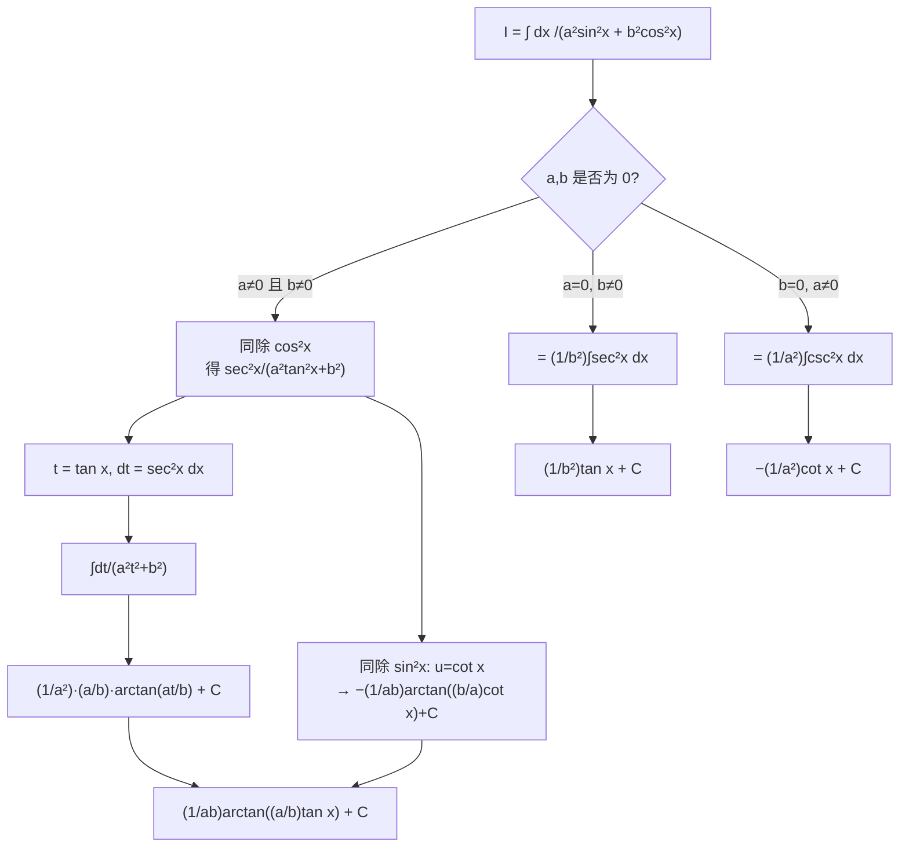

# 含参数三角有理式积分 $\displaystyle\int\frac{\mathrm{d}x}{a^{2}\sin^{2}x+b^{2}\cos^{2}x}$ 错题

## 错题信息

- 科目：高等数学
- 知识点：三角有理式积分（凑 $\mathrm{d}\tan x$）
- 题目来源：错题截图
- 我的答案：未作答
- 正确答案：$ab\neq 0$ 时 $\displaystyle I=\frac{1}{ab}\arctan\left(\frac{a}{b}\tan x\right)+C$（在每个不含 $x=\frac{\pi}{2}+k\pi$ 的区间上成立）

## 题目

计算不定积分

$$\int\frac{\mathrm{d}x}{a^{2}\sin^{2}x+b^{2}\cos^{2}x},\qquad \text{其中 } a,b \text{ 是不全为 }0\text{ 的非负常数.}$$

## 参考解答

### 一、凑微分法（主解，$ab\neq0$）

**第一步：分子分母同除 $\cos^{2}x$。**

$$\frac{1}{a^{2}\sin^{2}x+b^{2}\cos^{2}x}=\frac{\dfrac{1}{\cos^{2}x}}{a^{2}\dfrac{\sin^{2}x}{\cos^{2}x}+b^{2}}=\frac{\sec^{2}x}{a^{2}\tan^{2}x+b^{2}}$$

这一步是本题的**唯一入口**：除以 $\cos^{2}x$ 后，分子恰好是 $\sec^{2}x\,\mathrm{d}x=\mathrm{d}(\tan x)$，分母只剩 $\tan x$。

**第二步：换元 $t=\tan x$。**

$$\mathrm{d}t=\sec^{2}x\,\mathrm{d}x\quad\Longrightarrow\quad I=\int\frac{\mathrm{d}t}{a^{2}t^{2}+b^{2}}$$

**第三步：套 $\displaystyle\int\frac{\mathrm{d}t}{t^{2}+k^{2}}=\frac{1}{k}\arctan\frac{t}{k}+C$。**

$$I=\frac{1}{a^{2}}\int\frac{\mathrm{d}t}{t^{2}+\left(\frac{b}{a}\right)^{2}}=\frac{1}{a^{2}}\cdot\frac{a}{b}\arctan\frac{at}{b}+C=\frac{1}{ab}\arctan\left(\frac{a}{b}\tan x\right)+C$$

**第四步：求导回验（必须做，本题系数最容易错）。**

$$\frac{\mathrm{d}}{\mathrm{d}x}\left[\frac{1}{ab}\arctan\left(\frac{a}{b}\tan x\right)\right]=\frac{1}{ab}\cdot\frac{1}{1+\frac{a^{2}}{b^{2}}\tan^{2}x}\cdot\frac{a}{b}\sec^{2}x=\frac{\sec^{2}x}{b^{2}+a^{2}\tan^{2}x}=\frac{1}{a^{2}\sin^{2}x+b^{2}\cos^{2}x}$$

被积函数还原成功，答案成立。

### 二、同除 $\sin^{2}x$（等价形式，$ab\neq0$）

$$\frac{1}{a^{2}\sin^{2}x+b^{2}\cos^{2}x}=\frac{\csc^{2}x}{a^{2}+b^{2}\cot^{2}x},\qquad u=\cot x,\ \mathrm{d}u=-\csc^{2}x\,\mathrm{d}x$$

$$I=-\int\frac{\mathrm{d}u}{a^{2}+b^{2}u^{2}}=-\frac{1}{ab}\arctan\left(\frac{b}{a}\cot x\right)+C$$

两个结果**都是正确的原函数**，在同一个连续区间内相差常数：当 $x\in\left(0,\frac{\pi}{2}\right)$ 时 $\arctan\left(\frac{a}{b}\tan x\right)+\arctan\left(\frac{b}{a}\cot x\right)=\frac{\pi}{2}$，故

$$\frac{1}{ab}\arctan\left(\frac{a}{b}\tan x\right)=-\frac{1}{ab}\arctan\left(\frac{b}{a}\cot x\right)+\frac{\pi}{2ab}$$

> **做题提醒**：选择题里若同时出现这两个形式，**不能**把另一个当干扰项——它只是差了个常数。真正的干扰项是系数写成 $\frac{1}{a^{2}+b^{2}}$、或把 $\frac{a}{b}$ 写成 $\frac{b}{a}$ 的那一类。

### 三、退化情形（题目只说「不全为 0」，必须讨论）

| 情形 | 积分 | 结果 |
| --- | --- | --- |
| $a\neq0,\ b=0$ | $\displaystyle\frac{1}{a^{2}}\int\csc^{2}x\,\mathrm{d}x$ | $-\dfrac{1}{a^{2}}\cot x+C$ |
| $a=0,\ b\neq0$ | $\displaystyle\frac{1}{b^{2}}\int\sec^{2}x\,\mathrm{d}x$ | $\dfrac{1}{b^{2}}\tan x+C$ |
| $a=b\neq0$ | $\displaystyle\frac{1}{a^{2}}\int\mathrm{d}x$ | $\dfrac{x}{a^{2}}+C$ |

第三行也能用通式验证：$a=b$ 时通式给 $\frac{1}{a^{2}}\arctan(\tan x)+C$，在 $\left(-\frac{\pi}{2},\frac{\pi}{2}\right)$ 上 $\arctan(\tan x)=x$，与 $\frac{x}{a^{2}}+C$ 完全一致。

### 四、由不定积分直出的两个定积分结论（高频）

$$\int_{0}^{\frac{\pi}{2}}\frac{\mathrm{d}x}{a^{2}\sin^{2}x+b^{2}\cos^{2}x}=\frac{\pi}{2ab}\qquad(a,b>0)$$

理由：$F(x)=\frac{1}{ab}\arctan\left(\frac{a}{b}\tan x\right)$，$F(0)=0$，$x\to\frac{\pi}{2}^{-}$ 时 $\arctan\to\frac{\pi}{2}$，故 $F\left(\frac{\pi}{2}^{-}\right)=\frac{\pi}{2ab}$。

再用 $x\mapsto\pi-x$ 把 $\left[\frac{\pi}{2},\pi\right]$ 折回 $\left[0,\frac{\pi}{2}\right]$，得

$$\int_{0}^{\pi}\frac{\mathrm{d}x}{a^{2}\sin^{2}x+b^{2}\cos^{2}x}=\frac{\pi}{ab}\qquad(a,b>0)$$

> **数量级自检**：$a=b=1$ 时被积函数恒为 $1$，上式给 $\frac{\pi}{2}$、$\pi$，与真实值完全吻合；这是考场上 5 秒验算答案的办法。

## 根因分析

未作答，属首次接触此题型。本题的卡壳点按顺序有四个：

1. **找不到换元入口**：看到 $\sin^{2}x$ 与 $\cos^{2}x$ 同时出现，第一反应想用 $\sin^{2}x=\frac{1-\cos 2x}{2}$ 降次，得到 $\int\frac{2\,\mathrm{d}x}{(a^{2}+b^{2})+(b^{2}-a^{2})\cos 2x}$，再套 $\int\frac{\mathrm{d}u}{A+B\cos u}$ 公式，路越走越长且容易算错。**正确入口是「同除 $\cos^{2}x$ 凑 $\mathrm{d}\tan x$」**。
2. **换元后系数算错**：$\int\frac{\mathrm{d}t}{a^{2}t^{2}+b^{2}}$ 要先提 $\frac{1}{a^{2}}$，再对 $t^{2}+\left(\frac{b}{a}\right)^{2}$ 用 $\frac{1}{k}\arctan\frac{t}{k}$，两次系数相乘得 $\frac{1}{a^{2}}\cdot\frac{a}{b}=\frac{1}{ab}$。常见错误是直接写 $\frac{1}{a^{2}+b^{2}}\arctan(\tan x)$（量纲都不对：$a,b$ 同乘 $k$ 时左边缩为 $1/k^{2}$，而 $1/(a^{2}+b^{2})$ 缩为 $1/k^{2}$ 看似对，但对 $\tan$ 系数不敏感，求导立刻暴露）。
3. **忽略退化情形**：题干写「不全为 0」而不是「均大于 0」，$a=0$ 或 $b=0$ 必须单独讨论，否则分母除以 $\cos^{2}x$（或 $\sin^{2}x$）这一步就没有意义。
4. **忽略原函数的区间性**：$\tan x$ 在 $x=\frac{\pi}{2}+k\pi$ 处无定义，通式只在**每个不含这些点的区间**上是原函数，写「全体实数上的原函数」是错的。

## 完整知识点梳理

### 一、题型识别：分母是 $\sin^{2}x$、$\cos^{2}x$ 的**一次**组合

设被积函数形如

$$R(\sin^{2}x,\cos^{2}x)=\frac{1}{A\sin^{2}x+B\cos^{2}x}\quad\text{或}\quad\frac{1}{(A\sin^{2}x+B\cos^{2}x)^{n}}$$

（$n=1$ 用本档方法；$n\ge2$ 时同样先除 $\cos^{2}x$ 化成 $\int\frac{(1+t^{2})^{n-1}}{(At^{2}+B)^{n}}\mathrm{d}t$，再部分分式。）

判别口诀：**分母里 $\sin^{2}$、$\cos^{2}$ 都是偶次且只出现一次 → 除 $\cos^{2}x$ 换 $\tan x$；分子若还带 $\sin x\cos x$，同除 $\cos^{2}x$ 后变成 $\frac{\tan x}{A\tan^{2}x+B}\cdot\frac{\mathrm{d}t}{1+t^{2}}$ 型，再拆部分分式。**

### 二、核心换元链条

```
被积函数 1/(a²sin²x+b²cos²x)
        │  分子分母同除 cos²x
        ▼
sec²x /(a²tan²x+b²)
        │  t=tan x, dt=sec²x dx
        ▼
∫ dt/(a²t²+b²)
        │  提 1/a²，用 ∫du/(u²+k²)=(1/k)arctan(u/k)
        ▼
(1/ab)arctan((a/b)tan x)+C
```

**Mermaid 图例（两条等价路径 + 退化分支）**：



### 三、标准积分表（本题依赖的两条）

$$\int\frac{\mathrm{d}u}{u^{2}+k^{2}}=\frac{1}{k}\arctan\frac{u}{k}+C\qquad(k>0)$$

$$\int\sec^{2}x\,\mathrm{d}x=\tan x+C,\qquad \int\csc^{2}x\,\mathrm{d}x=-\cot x+C$$

### 四、与相邻题型的边界（避免用错方法）

| 被积函数形状 | 首选方法 | 关键动作 |
| --- | --- | --- |
| $\dfrac{1}{a^{2}\sin^{2}x+b^{2}\cos^{2}x}$ | 除 $\cos^{2}x$，$t=\tan x$ | 凑 $\mathrm{d}\tan x$ |
| $\dfrac{\sin x\cos x}{a^{2}\sin^{2}x+b^{2}\cos^{2}x}$ | 除 $\cos^{2}x$ 后 $t=\tan x$，或直接令 $u=\sin^{2}x$ | 分子凑 $\mathrm{d}(\sin^{2}x)$ |
| $\dfrac{1}{a\sin x+b\cos x}$ | 辅助角公式合并成一个 $\sin$ | 化成 $\int\csc$ 型 |
| $\dfrac{1}{a^{2}\sin^{2}x-b^{2}\cos^{2}x}$ | 除 $\cos^{2}x$ 后是 $\int\frac{\mathrm{d}t}{a^{2}t^{2}-b^{2}}$ | 改用**部分分式/反双曲**，不是 $\arctan$ |
| $\sin^{m}x\cos^{n}x$（$m,n$ 为偶数） | 降幂公式逐次降次 | 华里士/倍角 |


#### 例题：一次项分母 $\frac{1}{a\sin x+b\cos x}$ 怎么积（辅助角公式）

上表说「一次项用辅助角」，含义是把 $a\sin x+b\cos x$ 合成一个正弦，再套 $\int\csc$。看一道具体题就懂：

**例**：求 $\displaystyle\int\frac{\mathrm{d}x}{\sin x+\sqrt{3}\cos x}$。

**第一步：合成一个正弦**。用辅助角公式

$$a\sin x+b\cos x=R\sin(x+\varphi),\qquad R=\sqrt{a^{2}+b^{2}},\ \tan\varphi=\frac{b}{a}$$

这里 $a=1,\ b=\sqrt{3}$，所以 $R=\sqrt{1+3}=2$，$\tan\varphi=\sqrt{3}$，取 $\varphi=\frac{\pi}{3}$。于是

$$\sin x+\sqrt{3}\cos x=2\sin\left(x+\frac{\pi}{3}\right)$$

**为什么成立**：把右边展开 $2\sin(x+\frac{\pi}{3})=2\left(\sin x\cos\frac{\pi}{3}+\cos x\sin\frac{\pi}{3}\right)=2\left(\frac{1}{2}\sin x+\frac{\sqrt{3}}{2}\cos x\right)=\sin x+\sqrt{3}\cos x$，与左边一致。

**第二步：换成 $\csc$ 积分**。令 $u=x+\frac{\pi}{3}$（则 $\mathrm{d}u=\mathrm{d}x$）：

$$\int\frac{\mathrm{d}x}{\sin x+\sqrt{3}\cos x}=\frac{1}{2}\int\csc u\,\mathrm{d}u$$

**第三步：套 $\int\csc u\,\mathrm{d}u=\ln\left|\tan\frac{u}{2}\right|+C$**，代回 $u$：

$$\int\frac{\mathrm{d}x}{\sin x+\sqrt{3}\cos x}=\frac{1}{2}\ln\left|\tan\left(\frac{x}{2}+\frac{\pi}{6}\right)\right|+C$$

> 一句话记法：**一次项分母先合成 $R\sin(x+\varphi)$，剩下就是 $\frac{1}{R}\int\csc$**。$R=\sqrt{a^{2}+b^{2}}$，$\varphi$ 由 $\tan\varphi=\frac{b}{a}$ 定；若 $a=b$ 则 $\varphi=\frac{\pi}{4}$，若只有 $\cos$ 项相当于 $\varphi=\frac{\pi}{2}$（即 $\sec$）。
> **最容易混的一条**：分母中间是**减号**（$a^{2}\sin^{2}x-b^{2}\cos^{2}x$）时结果里是 $\ln\left|\frac{at-b}{at+b}\right|$ 型，不是 $\arctan$。看到平方和 → $\arctan$；看到平方差 → 对数。

### 五、原函数的区间性（易被忽略）

$F(x)=\frac{1}{ab}\arctan\left(\frac{a}{b}\tan x\right)$ 的表达式在 $x=\frac{\pi}{2}+k\pi$ 处无定义（$\tan x$ 发散），而原被积函数 $f(x)=\frac{1}{a^{2}\sin^{2}x+b^{2}\cos^{2}x}$ 处处连续有定义。所以严格写应该是：

$$\int\frac{\mathrm{d}x}{a^{2}\sin^{2}x+b^{2}\cos^{2}x}=\frac{1}{ab}\arctan\left(\frac{a}{b}\tan x\right)+C,\qquad x\in\left(-\frac{\pi}{2}+k\pi,\ \frac{\pi}{2}+k\pi\right)$$

在每个这样的区间内单独成立，各区间上的常数 $C$ 可以不同。考研解答题只需写出通式并注明「在各连续区间上」，不必逐段拼接。

## 考研速记规律（一看就会）

### 规律 1：见「$\sin^{2}$ 与 $\cos^{2}$ 的一次组合」→ 同除 $\cos^{2}x$

$$\frac{1}{a^{2}\sin^{2}x+b^{2}\cos^{2}x}\ \xrightarrow{\ \div\cos^{2}x\ }\ \frac{\sec^{2}x}{a^{2}\tan^{2}x+b^{2}}\ \xrightarrow{\ t=\tan x\ }\ \frac{\mathrm{d}t}{a^{2}t^{2}+b^{2}}$$

只要分母是 $\sin^{2}$、$\cos^{2}$ 的**一次**组合，这个入口永远有效，且不需要反解、不需要配方。

### 规律 2：系数是 $\frac{1}{ab}$，不是 $\frac{1}{a^{2}+b^{2}}$

$$\int\frac{\mathrm{d}x}{a^{2}\sin^{2}x+b^{2}\cos^{2}x}=\frac{1}{ab}\arctan\left(\frac{a}{b}\tan x\right)+C$$

**量纲自检**：把 $(a,b)$ 同乘 $k$，左边被积函数变为原来的 $\frac{1}{k^{2}}$，答案也应缩为 $\frac{1}{k^{2}}$。检验 $\frac{1}{ab}\to\frac{1}{k^{2}ab}$ ✅；$\frac{1}{a^{2}+b^{2}}\to\frac{1}{k^{2}(a^{2}+b^{2})}$ 也缩了，但**系数具体值**不同——用 $a=1,b=2$ 代入求导即可分辨：正确者是 $\frac{1}{2}\arctan\left(\frac{\tan x}{2}\right)$。

### 规律 3：定积分「$\frac{\pi}{2}$ 出 $\frac{\pi}{2ab}$，翻倍到 $\pi$」

$$\int_{0}^{\frac{\pi}{2}}\frac{\mathrm{d}x}{a^{2}\sin^{2}x+b^{2}\cos^{2}x}=\frac{\pi}{2ab},\qquad \int_{0}^{\pi}\frac{\mathrm{d}x}{a^{2}\sin^{2}x+b^{2}\cos^{2}x}=\frac{\pi}{ab}\quad(a,b>0)$$

记忆锚点：**「上限带 $\frac{\pi}{2}$，答案带 $\frac{\pi}{2}$；上限到 $\pi$，答案翻倍。」** 用 $a=b=1$（被积函数恒为 1）秒验：$\frac{\pi}{2}$、$\pi$ ✅。

### 规律 4：退化情形「缺谁积谁」

| 缺项 | 结果 | 记法 |
| --- | --- | --- |
| $b=0$（只剩 $\sin^{2}$） | $-\frac{1}{a^{2}}\cot x+C$ | 只剩 $\sin$ → 积出 $-\cot$ |
| $a=0$（只剩 $\cos^{2}$） | $\frac{1}{b^{2}}\tan x+C$ | 只剩 $\cos$ → 积出 $\tan$ |
| $a=b$ | $\frac{x}{a^{2}}+C$ | 分母恒为 $a^{2}$，积出 $x$ |

### 规律 5：等价形式别当错项

$$-\frac{1}{ab}\arctan\left(\frac{b}{a}\cot x\right)+C\quad\text{与}\quad\frac{1}{ab}\arctan\left(\frac{a}{b}\tan x\right)+C$$

在同一个连续区间内**只差常数** $\frac{\pi}{2ab}$，两者都对。选择题排错要盯「系数」和「$\frac{a}{b}$ 的上下位置」，不要盯着 $\tan/\cot$。

### 规律 6：与相邻题型的边界——「一眼定方法，别走错路」

把「四、与相邻题型的边界（避免用错方法）」压缩成 30 秒速判表：**先看分母里三角函数的形状，再定入口**，不要一上来就降幂或万能代换。

| 一眼看到的形状 | 立刻用 | 最容易误走的路 |
| --- | --- | --- |
| $\sin^{2}$、$\cos^{2}$ 的**平方和** $\dfrac{1}{a^{2}\sin^{2}x+b^{2}\cos^{2}x}$ | 除 $\cos^{2}x$，$t=\tan x$ → $\arctan$ | 降幂 / 万能代换（越算越长） |
| $\sin^{2}$、$\cos^{2}$ 的**平方差** $\dfrac{1}{a^{2}\sin^{2}x-b^{2}\cos^{2}x}$ | 除 $\cos^{2}x$ 后部分分式 → $\ln\left\|\frac{at-b}{at+b}\right\|$ | **套 $\arctan$（最高频丢分点）** |
| 分子带 $\sin x\cos x$ | 直接令 $u=\sin^{2}x$ 凑 $\mathrm{d}(\sin^{2}x)$ | 硬除 $\cos^{2}x$ 再换元 |
| 分母是**一次项** $\dfrac{1}{a\sin x+b\cos x}$ | 辅助角合成一个 $\sin$ → $\int\csc$ | 除 $\cos^{2}x$（用不上） |
| 纯乘积 $\sin^{m}x\cos^{n}x$（$m,n$ 偶数） | 降幂 + 华里士 | 换 $\tan x$ |

**为什么平方差变对数**：除 $\cos^{2}x$ 后分别是

$$\int\frac{\mathrm{d}t}{a^{2}t^{2}+b^{2}}=\frac{1}{ab}\arctan\frac{at}{b}+C,\qquad \int\frac{\mathrm{d}t}{a^{2}t^{2}-b^{2}}=\frac{1}{2ab}\ln\left|\frac{at-b}{at+b}\right|+C$$

**符号一变，函数族就从 $\arctan$ 变成 $\ln$**：$t^{2}+k^{2}$ 只能配方成反正切，$t^{2}-k^{2}$ 能因式分解 $(at-b)(at+b)$ 所以出对数。考场上看到分母中间是减号，直接在对数区找答案。

> **边界口诀**：**「平方和出 $\arctan$，平方差出 $\ln$；分子带 $\sin\cos$ 凑平方，一次项用辅助角；纯乘积降幂算。」** 完整边界表见「四、与相邻题型的边界」。

> **总口诀**：**「平方组合除余弦，sec 平方凑正切；系数一除 a 乘 b，上下限出二分之 $\pi$。」**

## 复刷清单

### 举一反三 5 题（双端同步）

1. $\displaystyle\int\frac{\mathrm{d}x}{a^{2}\sin^{2}x+b^{2}\cos^{2}x}$（$a,b>0$）的结果是？
   **答案**：$\frac{1}{ab}\arctan\left(\frac{a}{b}\tan x\right)+C$。
2. 计算该积分时，第一步应对被积函数的分子分母同除什么？
   **答案**：$\cos^{2}x$，使分子变成 $\sec^{2}x=\frac{\mathrm{d}(\tan x)}{\mathrm{d}x}$。
3. 令 $t=\tan x$ 后，原积分化为哪个形式？
   **答案**：$\displaystyle\int\frac{\mathrm{d}t}{a^{2}t^{2}+b^{2}}$。
4. $\displaystyle\int\frac{\mathrm{d}x}{\sin^{2}x+4\cos^{2}x}=$？
   **答案**：$a=1,b=2$，$\frac{1}{ab}=\frac{1}{2}$，$\frac{a}{b}=\frac{1}{2}$，故 $\frac{1}{2}\arctan\left(\frac{\tan x}{2}\right)+C$。
5. $\displaystyle\int\frac{\mathrm{d}x}{a^{2}\sin^{2}x}$（$a\neq0$）=？
   **答案**：$-\frac{1}{a^{2}}\cot x+C$。

### 历年真题风格练习（双端同步）

1. 【统考真题风格】设 $a,b>0$，则 $\displaystyle\int_{0}^{\frac{\pi}{2}}\frac{\mathrm{d}x}{a^{2}\sin^{2}x+b^{2}\cos^{2}x}=$？
   **答案**：$\frac{\pi}{2ab}$。
2. 【真题风格】$\displaystyle\int\frac{\mathrm{d}x}{3\sin^{2}x+\cos^{2}x}=$？
   **答案**：$a=\sqrt{3},b=1$，$\frac{1}{ab}=\frac{1}{\sqrt{3}}$，$\frac{a}{b}=\sqrt{3}$，故 $\frac{1}{\sqrt{3}}\arctan\left(\sqrt{3}\tan x\right)+C$。
3. 【真题风格】$\displaystyle\int_{0}^{\frac{\pi}{2}}\frac{\mathrm{d}x}{\sin^{2}x+4\cos^{2}x}=$？
   **答案**：$\frac{\pi}{2\cdot1\cdot2}=\frac{\pi}{4}$。
4. 【真题改编】当 $a=b\neq0$ 时，$\displaystyle\int\frac{\mathrm{d}x}{a^{2}\sin^{2}x+b^{2}\cos^{2}x}=$？
   **答案**：分母恒为 $a^{2}$，故 $\frac{x}{a^{2}}+C$。
5. 【真题风格·概念】关于 $F(x)=\dfrac{1}{ab}\arctan\left(\dfrac{a}{b}\tan x\right)$，正确的说法是？
   **答案**：它在每个不含 $x=\frac{\pi}{2}+k\pi$ 的开区间上是 $\frac{1}{a^{2}\sin^{2}x+b^{2}\cos^{2}x}$ 的原函数；不能笼统说「在整个实轴上」。

## 复习记录

- 2026-11-20：用户发送题目截图（未作答），按规则直接收录为错题；quiz 5 道复刷 + 5 道真题风格，艾宾浩斯第 1 轮 5 题，次日（2026-11-21）到期。
- 代数验证（Node 数值微分，$h=10^{-6}$，区间 $x\in[0.15,1.4]$）：通式 $\frac{1}{ab}\arctan\left(\frac{a}{b}\tan x\right)$ 在 $(a,b)=(2,3),(1,2),(\sqrt{3},1)$ 三组下，导数与被积函数最大误差分别为 $3.0\times10^{-11}$、$8.2\times10^{-11}$、$8.3\times10^{-11}$，全部通过；退化情形 $-\frac{1}{4}\cot x$（$a=2,b=0$）、$\frac{1}{4}\tan x$（$a=0,b=2$）、$x$（$a=b=1$）导数误差均 $<5\times10^{-10}$，通过；干扰项反向确认 $\frac{1}{ab}\arctan\left(\frac{b}{a}\tan x\right)$ 误差 $1.3\times10^{-1}$、$\frac{1}{a^{2}+b^{2}}\arctan(\tan x)$ 误差 $1.6\times10^{-1}$，确认为错项。
- 定积分验证（Simpson，$n=2\times10^{5}$）：$\int_{0}^{\pi/2}\frac{\mathrm{d}x}{\sin^{2}x+4\cos^{2}x}$ 数值 $0.7853981624$ 与 $\frac{\pi}{4}=0.7853981634$ 一致（误差 $1.0\times10^{-9}$）；通式 $\frac{\pi}{2ab}$ 在 $(2,3),(1,2),(\sqrt{3},1)$ 三组下误差均 $<10^{-9}$，通过。
- 大模型二次验证：调用 `deepseek-v4-pro` API（本地 https://127.0.0.1:3800/v1）独立作答原题 + 10 道复刷/真题题。原题结论与档案完全一致（$ab\neq0$ 为 $\frac{1}{ab}\arctan(\frac{a}{b}\tan x)+C$；$a=0$ 为 $\frac{\tan x}{b^{2}}+C$；$b=0$ 为 $-\frac{\cot x}{a^{2}}+C$；$a=b$ 为 $\frac{x}{a^{2}}+C$；$\int_{0}^{\pi/2}=\frac{\pi}{2ab}$，并补充 $a=0$ 或 $b=0$ 时定积分发散）。10 道选择题模型全部返回 A，与本地答案（10×A）一致，✅ 无分歧，无需仲裁，入库。
