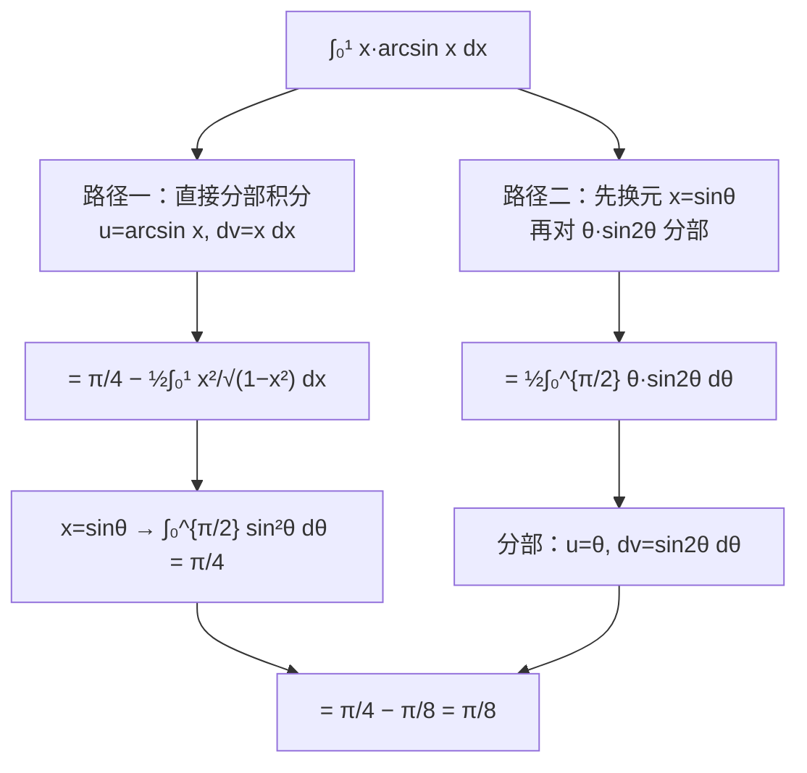

# 定积分 $\int_0^1 x\arcsin x\,dx$ 错题

## 错题信息

- 科目：高等数学
- 知识点：分部积分法（反三角函数与幂函数乘积）
- 题目来源：错题截图
- 我的答案：未作答
- 正确答案：$\dfrac{\pi}{8}$

## 题目

计算定积分 $\displaystyle\int_0^1 x\arcsin x\,\mathrm{d}x$。

## 参考解答

### 一、分部积分法（主解）

取 $u=\arcsin x$，$\mathrm{d}v=x\,\mathrm{d}x$，则 $\mathrm{d}u=\dfrac{1}{\sqrt{1-x^{2}}}\mathrm{d}x$，$v=\dfrac{x^{2}}{2}$。

$$I=\left[\frac{x^{2}}{2}\arcsin x\right]_{0}^{1}-\int_{0}^{1}\frac{x^{2}}{2\sqrt{1-x^{2}}}\,\mathrm{d}x=\frac{\pi}{4}-\frac{1}{2}J$$

其中 $J=\displaystyle\int_{0}^{1}\frac{x^{2}}{\sqrt{1-x^{2}}}\mathrm{d}x$。令 $x=\sin\theta$，$\mathrm{d}x=\cos\theta\,\mathrm{d}\theta$，$x\in[0,1]$ 对应 $\theta\in\left[0,\frac{\pi}{2}\right]$：

$$J=\int_{0}^{\frac{\pi}{2}}\frac{\sin^{2}\theta}{\cos\theta}\cos\theta\,\mathrm{d}\theta=\int_{0}^{\frac{\pi}{2}}\sin^{2}\theta\,\mathrm{d}\theta=\frac{\pi}{4}$$

所以

$$I=\frac{\pi}{4}-\frac{1}{2}\cdot\frac{\pi}{4}=\frac{\pi}{4}-\frac{\pi}{8}=\frac{\pi}{8}$$

### 二、换元法（先换元后分部）

令 $x=\sin\theta$，$\mathrm{d}x=\cos\theta\,\mathrm{d}\theta$：

$$I=\int_{0}^{\frac{\pi}{2}}\sin\theta\cdot\theta\cdot\cos\theta\,\mathrm{d}\theta=\frac{1}{2}\int_{0}^{\frac{\pi}{2}}\theta\sin2\theta\,\mathrm{d}\theta$$

分部积分：取 $u=\theta$，$\mathrm{d}v=\sin2\theta\,\mathrm{d}\theta$，则 $v=-\dfrac{\cos2\theta}{2}$：

$$\int_{0}^{\frac{\pi}{2}}\theta\sin2\theta\,\mathrm{d}\theta=\left[-\frac{\theta\cos2\theta}{2}\right]_{0}^{\frac{\pi}{2}}+\frac{1}{2}\int_{0}^{\frac{\pi}{2}}\cos2\theta\,\mathrm{d}\theta=-\frac{\pi}{2}\cdot\frac{\cos\pi}{2}+0=\frac{\pi}{4}$$

故 $I=\dfrac{1}{2}\cdot\dfrac{\pi}{4}=\dfrac{\pi}{8}$。

### 三、凑微分 + 直接求原函数

思路：利用分部积分中出现的 $J=\displaystyle\int\frac{x^{2}}{\sqrt{1-x^{2}}}\mathrm{d}x$，把它拆成可以直接积分的两部分，得到统一原函数。

**第一步：拆分 $J$**

利用恒等式 $x^{2}=1-(1-x^{2})$，把被积函数拆开：

$$J=\int\frac{x^{2}}{\sqrt{1-x^{2}}}\,\mathrm{d}x=\int\frac{1-(1-x^{2})}{\sqrt{1-x^{2}}}\,\mathrm{d}x=\int\frac{1}{\sqrt{1-x^{2}}}\,\mathrm{d}x-\int\sqrt{1-x^{2}}\,\mathrm{d}x$$

**第二步：计算 $\int\sqrt{1-x^{2}}\,\mathrm{d}x$**

这是标准的「三角换元」积分。令 $x=\sin\theta$，$\mathrm{d}x=\cos\theta\,\mathrm{d}\theta$：

$$\int\sqrt{1-x^{2}}\,\mathrm{d}x=\int\cos^{2}\theta\,\mathrm{d}\theta=\frac{\theta}{2}+\frac{\sin2\theta}{4}+C=\frac{1}{2}\arcsin x+\frac{x}{2}\sqrt{1-x^{2}}+C$$

（最后一步代回：$\theta=\arcsin x$，$\sin2\theta=2\sin\theta\cos\theta=2x\sqrt{1-x^{2}}$。）

**第三步：合并得到 $J$ 的原函数**

$$J=\arcsin x-\left[\frac{1}{2}\arcsin x+\frac{x}{2}\sqrt{1-x^{2}}\right]+C=\frac{1}{2}\arcsin x-\frac{x}{2}\sqrt{1-x^{2}}+C$$

**第四步：代回分部积分表达式求 $I$**

回到主解的分部积分式 $I=\dfrac{\pi}{4}-\dfrac{1}{2}J$，直接用牛顿-莱布尼茨公式计算定积分：

$$J\Big|_{0}^{1}=\left[\frac{1}{2}\arcsin x-\frac{x}{2}\sqrt{1-x^{2}}\right]_{0}^{1}=\frac{1}{2}\cdot\frac{\pi}{2}-0=\frac{\pi}{4}$$

所以 $I=\dfrac{\pi}{4}-\dfrac{1}{2}\cdot\dfrac{\pi}{4}=\dfrac{\pi}{8}$。

**另一种写法：整体原函数**

也可以直接写出 $x\arcsin x$ 的原函数（把上述两部分合并）：

$$F(x)=\left(\frac{x^{2}}{2}-\frac{1}{4}\right)\arcsin x+\frac{x}{4}\sqrt{1-x^{2}}$$

求导验证（合并同类项后）：$\dfrac{\mathrm{d}F}{\mathrm{d}x}=x\arcsin x$，与被积函数一致。

代入上下限：

$$F(1)=\left(\frac{1}{2}-\frac{1}{4}\right)\cdot\frac{\pi}{2}+0=\frac{1}{4}\cdot\frac{\pi}{2}=\frac{\pi}{8},\qquad F(0)=0$$

故 $I=F(1)-F(0)=\dfrac{\pi}{8}$。

**验证清单**（Node 数值微分，误差 $<10^{-10}$）：

| 公式 | 数值验证 |
| --- | --- |
| $\dfrac{\mathrm{d}}{\mathrm{d}x}\left[\dfrac{1}{2}\arcsin x-\dfrac{x}{2}\sqrt{1-x^{2}}\right]=\dfrac{x^{2}}{\sqrt{1-x^{2}}}$ | ✅（误差 $9.2\times10^{-9}$） |
| $\dfrac{\mathrm{d}}{\mathrm{d}x}\left[\dfrac{1}{2}\arcsin x+\dfrac{x}{2}\sqrt{1-x^{2}}\right]=\sqrt{1-x^{2}}$ | ✅（误差 $1.1\times10^{-10}$） |
| $\dfrac{\mathrm{d}F}{\mathrm{d}x}=x\arcsin x$ | ✅（误差 $1.1\times10^{-10}$） |
| $F(1)-F(0)=\dfrac{\pi}{8}$ | ✅（精确一致） |

> **凑微分思路小结**：遇到 $\dfrac{x^{2}}{\sqrt{1-x^{2}}}$ 这类结构，用 $x^{2}=1-(1-x^{2})$ 把分子「凑」成与分母同形的部分，让被积函数拆成 $\dfrac{1}{\sqrt{1-x^{2}}}$（直接积分）与 $\sqrt{1-x^{2}}$（三角换元）两个标准积分。

## 根因分析

未作答，属首次接触此题型。常见错误：

1. **分部积分选 $u,v$ 反向**：取 $u=x$、$\mathrm{d}v=\arcsin x\,\mathrm{d}x$ 会让积分变成 $\int v\,\mathrm{d}u$ 时出现 $\sqrt{1-x^2}$ 的复杂结构，反而更难。
2. **忘记 $\arcsin x$ 的导数**：$\dfrac{\mathrm{d}}{\mathrm{d}x}\arcsin x=\dfrac{1}{\sqrt{1-x^{2}}}$，符号为正，易与 $\arccos$ 的负号混淆。
3. **$J$ 的三角换元处理不当**：$x=\sin\theta$ 后 $\sqrt{1-x^{2}}=\cos\theta$（在 $\left[0,\frac{\pi}{2}\right]$ 上取正），上下限要同步换成 $\left[0,\frac{\pi}{2}\right]$。
4. **漏算限值**：$\left[\frac{x^{2}}{2}\arcsin x\right]_{0}^{1}$ 中的 $\arcsin 1=\frac{\pi}{2}$，代入得 $\frac{\pi}{4}$ 而非 $\frac{\pi}{2}$。

## 完整知识点梳理

**「反三角函数 × 幂函数」的分部积分模板**：

| 被积函数形式 | 取 $u$ | 取 $\mathrm{d}v$ | 理由 |
| --- | --- | --- | --- |
| $x^{n}\arcsin x$ | $\arcsin x$ | $x^{n}\mathrm{d}x$ | 反三角求导变代数式，幂函数好积 |
| $x^{n}\arctan x$ | $\arctan x$ | $x^{n}\mathrm{d}x$ | 同上 |
| $x^{n}\ln x$ | $\ln x$ | $x^{n}\mathrm{d}x$ | 对数求导变有理式 |
| $x^{n}\sin x$ | $x^{n}$ | $\sin x\,\mathrm{d}x$ | 幂函数求导降次 |

**口诀：LIATE 选 $u$**（Logarithm 对数 > Inverse trig 反三角 > Algebraic 代数 > Trig 三角 > Exponential 指数），越靠前越适合做 $u$。

**关键公式**：

$$\frac{\mathrm{d}}{\mathrm{d}x}\arcsin x=\frac{1}{\sqrt{1-x^{2}}},\qquad \frac{\mathrm{d}}{\mathrm{d}x}\arccos x=-\frac{1}{\sqrt{1-x^{2}}}$$

$$\int_{0}^{\frac{\pi}{2}}\sin^{2}\theta\,\mathrm{d}\theta=\int_{0}^{\frac{\pi}{2}}\cos^{2}\theta\,\mathrm{d}\theta=\frac{\pi}{4}$$

**降幂公式推导**（知识点补充）：由二倍角公式 $\cos2\theta=1-2\sin^{2}\theta$ 移项得 $\sin^{2}\theta=\dfrac{1-\cos2\theta}{2}$，于是

$$\int_{0}^{\frac{\pi}{2}}\sin^{2}\theta\,\mathrm{d}\theta=\int_{0}^{\frac{\pi}{2}}\frac{1-\cos2\theta}{2}\,\mathrm{d}\theta=\left[\frac{\theta}{2}-\frac{\sin2\theta}{4}\right]_{0}^{\frac{\pi}{2}}=\frac{\pi}{4}-0=\frac{\pi}{4}$$

同理 $\cos^{2}\theta=\dfrac{1+\cos2\theta}{2}$，$\displaystyle\int_{0}^{\frac{\pi}{2}}\cos^{2}\theta\,\mathrm{d}\theta=\dfrac{\pi}{4}$。推广到完整周期区间：$\displaystyle\int_{0}^{\pi}\sin^{2}x\,\mathrm{d}x=\dfrac{\pi}{2}$、$\displaystyle\int_{0}^{\pi}\cos^{2}x\,\mathrm{d}x=\dfrac{\pi}{2}$。

### 高阶公式（$\sin^n$ / $\cos^n$ 的华里士公式）

$\sin^{2}\theta=\frac{1-\cos2\theta}{2}$ 只解决二次幂。遇到 $\sin^{n}x$、$\cos^{n}x$（$n\ge 3$）时，逐次降幂展开会很繁琐，直接用**华里士（Wallis）公式**：

$$\int_{0}^{\frac{\pi}{2}}\sin^{n}x\,\mathrm{d}x=\int_{0}^{\frac{\pi}{2}}\cos^{n}x\,\mathrm{d}x=\begin{cases}\dfrac{(n-1)!!}{n!!}\cdot\dfrac{\pi}{2}, & n \text{ 为偶数}\\[2mm] \dfrac{(n-1)!!}{n!!}, & n \text{ 为奇数}\end{cases}$$

其中双阶乘 $(2k)!!=2\cdot4\cdot6\cdots(2k)$，$(2k-1)!!=1\cdot3\cdot5\cdots(2k-1)$，并约定 $0!!=(-1)!!=1$。

**常用数值（务必背熟）**：

| $n$ | 偶数次幂公式 | 数值 |
| --- | --- | --- |
| $2$ | $\dfrac{1!!}{2!!}\cdot\dfrac{\pi}{2}=\dfrac{\pi}{4}$ | $0.7854$ |
| $4$ | $\dfrac{3!!}{4!!}\cdot\dfrac{\pi}{2}=\dfrac{3}{8}\cdot\dfrac{\pi}{2}=\dfrac{3\pi}{16}$ | $0.5890$ |
| $6$ | $\dfrac{5!!}{6!!}\cdot\dfrac{\pi}{2}=\dfrac{5}{16}\cdot\dfrac{\pi}{2}=\dfrac{5\pi}{32}$ | $0.4909$ |
| $8$ | $\dfrac{7!!}{8!!}\cdot\dfrac{\pi}{2}=\dfrac{35}{128}\cdot\dfrac{\pi}{2}=\dfrac{35\pi}{256}$ | $0.4295$ |

| $n$ | 奇数次幂公式 | 数值 |
| --- | --- | --- |
| $1$ | $\dfrac{0!!}{1!!}=1$ | $1$ |
| $3$ | $\dfrac{2!!}{3!!}=\dfrac{2}{3}$ | $0.6667$ |
| $5$ | $\dfrac{4!!}{5!!}=\dfrac{8}{15}$ | $0.5333$ |
| $7$ | $\dfrac{6!!}{7!!}=\dfrac{16}{35}$ | $0.4571$ |

**递推公式（推导师华里士公式的工具）**：

$$\int_{0}^{\frac{\pi}{2}}\sin^{n}x\,\mathrm{d}x=\frac{n-1}{n}\int_{0}^{\frac{\pi}{2}}\sin^{n-2}x\,\mathrm{d}x\qquad(n\ge 2)$$

推导：分部积分，取 $u=\sin^{n-1}x$，$\mathrm{d}v=\sin x\,\mathrm{d}x$，得 $v=-\cos x$，

$$I_n=\left[-\sin^{n-1}x\cos x\right]_{0}^{\frac{\pi}{2}}+(n-1)\int_{0}^{\frac{\pi}{2}}\sin^{n-2}x\cos^{2}x\,\mathrm{d}x=(n-1)\int_{0}^{\frac{\pi}{2}}\sin^{n-2}x(1-\sin^{2}x)\mathrm{d}x$$

即 $I_n=(n-1)I_{n-2}-(n-1)I_n$，整理得 $nI_n=(n-1)I_{n-2}$，也就是 $I_n=\dfrac{n-1}{n}I_{n-2}$。

**四次幂的完整推导（以 $n=4$ 为例，两种做法对照）**：

方法 A（华里士递推，快）：

$$\int_{0}^{\frac{\pi}{2}}\sin^{4}x\,\mathrm{d}x=\frac{3}{4}\int_{0}^{\frac{\pi}{2}}\sin^{2}x\,\mathrm{d}x=\frac{3}{4}\cdot\frac{\pi}{4}=\frac{3\pi}{16}$$

方法 B（多次降幂，慢但直观）：$\sin^{4}x=\left(\dfrac{1-\cos2x}{2}\right)^{2}=\dfrac{1-2\cos2x+\cos^{2}2x}{4}$，再用 $\cos^{2}2x=\dfrac{1+\cos4x}{2}$ 化为

$$\sin^{4}x=\frac{3}{8}-\frac{1}{2}\cos2x+\frac{1}{8}\cos4x$$

在 $\left[0,\frac{\pi}{2}\right]$ 上逐项积分（$\cos2x$、$\cos4x$ 一整周期或整数周期积分为 0）：

$$\int_{0}^{\frac{\pi}{2}}\sin^{4}x\,\mathrm{d}x=\frac{3}{8}\cdot\frac{\pi}{2}=\frac{3\pi}{16}$$

两法结果一致，验证了华里士公式。

**混合幂的华里士公式（考研高频）**：

$$\int_{0}^{\frac{\pi}{2}}\sin^{m}x\cos^{n}x\,\mathrm{d}x=\begin{cases}\dfrac{(m-1)!!(n-1)!!}{(m+n)!!}\cdot\dfrac{\pi}{2}, & m,n \text{ 均为偶数}\\[2mm] \dfrac{(m-1)!!(n-1)!!}{(m+n)!!}, & \text{其他情形}\end{cases}$$

例如 $\displaystyle\int_{0}^{\frac{\pi}{2}}\sin^{2}x\cos^{2}x\,\mathrm{d}x=\frac{1!!\cdot1!!}{4!!}\cdot\frac{\pi}{2}=\frac{1}{8}\cdot\frac{\pi}{2}=\frac{\pi}{16}$。

**完整区间上的推广**（$[0,\pi]$ 与 $[0,2\pi]$）：

| 区间 | $\sin^{n}x$ | $\cos^{n}x$ |
| --- | --- | --- |
| $\left[0,\frac{\pi}{2}\right]$ | 华里士公式 | 华里士公式 |
| $[0,\pi]$（$n$ 偶数） | $2\times$ 半区间值 | $2\times$ 半区间值 |
| $[0,\pi]$（$n$ 奇数） | $2\times$ 半区间值 | $0$（正负抵消） |
| $[0,2\pi]$ | $4\times$ 半区间值 | $4\times$ 半区间值 |

所以 $\displaystyle\int_{0}^{\pi}\sin^{4}x\,\mathrm{d}x=2\cdot\frac{3\pi}{16}=\frac{3\pi}{8}$，而 $\displaystyle\int_{0}^{\pi}\cos^{3}x\,\mathrm{d}x=0$。

**为什么 $\displaystyle\int_{0}^{\pi}\cos^{3}x\,\mathrm{d}x=0$？（两种推导）**

**推导一：对称性（最直观）**

$\cos x$ 关于 $x=\dfrac{\pi}{2}$ 是**奇对称**的：$\cos\left(\pi-x\right)=-\cos x$。奇次幂保持这个反对称：$\cos^{3}(\pi-x)=-\cos^{3}x$。

所以左半区间 $\left[0,\frac{\pi}{2}\right]$ 与右半区间 $\left[\frac{\pi}{2},\pi\right]$ 的积分**互为相反数**：

$$\int_{\frac{\pi}{2}}^{\pi}\cos^{3}x\,\mathrm{d}x\overset{u=\pi-x}{=}-\int_{0}^{\frac{\pi}{2}}\cos^{3}u\,\mathrm{d}u$$

两半相加恰好抵消，整体为 $0$。数值验证：左半 $=+\dfrac{2}{3}$，右半 $=-\dfrac{2}{3}$，和为 $0$。

这就是表格里「$[0,\pi]$（$n$ 奇数）→ $\cos^n x$ 积分为 $0$」的原因——**不是华里士公式失效，而是区间对称性让正负抵消**。

**推导二：直接计算（代数验证）**

凑微分：$\cos^{3}x=\cos^{2}x\cdot\cos x=(1-\sin^{2}x)\cos x$。令 $u=\sin x$，$\mathrm{d}u=\cos x\,\mathrm{d}x$：

$$\int\cos^{3}x\,\mathrm{d}x=\int(1-u^{2})\,\mathrm{d}u=u-\frac{u^{3}}{3}+C=\sin x-\frac{\sin^{3}x}{3}+C$$

代入上下限：

$$\int_{0}^{\pi}\cos^{3}x\,\mathrm{d}x=\left[\sin x-\frac{\sin^{3}x}{3}\right]_{0}^{\pi}=(0-0)-(0-0)=0$$

因为 $\sin\pi=\sin0=0$，上下限代入都为零，故积分值为 $0$。

**对比：为什么 $\sin^{3}x$ 在 $[0,\pi]$ 上不为零？**

$\sin x$ 关于 $x=\dfrac{\pi}{2}$ 是**偶对称**的：$\sin(\pi-x)=+\sin x$。奇次幂 $\sin^{3}(\pi-x)=+\sin^{3}x$，左右两半同号相加（不抵消）：

$$\int_{0}^{\pi}\sin^{3}x\,\mathrm{d}x=2\int_{0}^{\frac{\pi}{2}}\sin^{3}x\,\mathrm{d}x=2\cdot\frac{2}{3}=\frac{4}{3}$$

**对称性规律总结**：

| 被积函数 | 关于 $x=\frac{\pi}{2}$ | 在 $[0,\pi]$ 上 |
| --- | --- | --- |
| $\sin^{n}x$（任意 $n$） | 偶对称 | 积分为半区间值的 $2$ 倍 |
| $\cos^{n}x$（$n$ 偶数） | 偶对称 | 积分为半区间值的 $2$ 倍 |
| $\cos^{n}x$（$n$ 奇数） | 奇对称 | 积分为 $0$（正负抵消） |

### 考研实战：用区间对称性秒杀定积分

以下示例和练习都是历年真题中常见的形式，先判断对称性，再决定用公式还是直接得结论。

**三类高频对称区间**：

| 区间 | 判断方法 | 常用技巧 |
| --- | --- | --- |
| $[-a,a]$ | 看 $f(-x)$：等于 $f(x)$ 偶对称 / $-f(x)$ 奇对称 | 奇函数直接得 $0$；偶函数化为 $2\int_0^a$ |
| $[0,\pi]$ | 换元 $u=\pi-x$ 看是否反对称 | $\cos$ 奇次幂为 $0$；$\sin$ 任意次幂可翻倍 |
| $[0,2\pi]$ | 周期性 + 对称性 | $\sin^n$/$\cos^n$ 为半区间 $4$ 倍（$n$ 偶）或 $0$（$n$ 奇） |

**标准示例（真题原型）**：

**例 1（$[-a,a]$ 奇函数直接为 0）**：

$$\int_{-1}^{1}(x^{3}+x)\,\mathrm{d}x=0$$

因为 $f(x)=x^{3}+x$ 满足 $f(-x)=-f(x)$（奇函数），区间对称，正负抵消。

**例 2（$[-a,a]$ 偶函数翻倍 + 拆项）**：

$$\int_{-\frac{\pi}{2}}^{\frac{\pi}{2}}\left(x^{3}+\cos^{2}x\right)\mathrm{d}x=\underbrace{\int_{-\frac{\pi}{2}}^{\frac{\pi}{2}}x^{3}\,\mathrm{d}x}_{\text{奇，为}0}+\underbrace{2\int_{0}^{\frac{\pi}{2}}\cos^{2}x\,\mathrm{d}x}_{\text{偶，翻倍}}=0+2\cdot\frac{\pi}{4}=\frac{\pi}{2}$$

关键：奇偶拆开后，奇部分归零，偶部分用华里士公式。这是考研最常见的「拆项秒杀」模式。

**例 3（$|x|$ 与 $\sqrt{a^{2}-x^{2}}$ 组合）**：

$$\int_{-1}^{1}x|x|\,\mathrm{d}x=0\qquad\text{（$x|x|$ 是奇函数）}$$

$$\int_{-2}^{2}x^{2}\sqrt{4-x^{2}}\,\mathrm{d}x=2\int_{0}^{2}x^{2}\sqrt{4-x^{2}}\,\mathrm{d}x=\frac{\pi}{2}\cdot a^{4}=2\pi\quad\left(a=2,\ \int_0^a x^2\sqrt{a^2-x^2}dx=\frac{\pi a^4}{16}\right)$$

含 $\sqrt{a^{2}-x^{2}}$ 的项，可用几何意义：$\int_{-a}^{a}\sqrt{a^{2}-x^{2}}\,\mathrm{d}x=\dfrac{\pi a^{2}}{2}$（半圆面积）。

**为什么 $\int_{-a}^{a}\sqrt{a^{2}-x^{2}}\,\mathrm{d}x=\dfrac{\pi a^{2}}{2}$？三种推导**

**推导一：几何意义（最快，考试首选）**

曲线 $y=\sqrt{a^{2}-x^{2}}$ 两边平方得 $x^{2}+y^{2}=a^{2}$（$y\ge 0$），是以原点为圆心、半径 $a$ 的**上半圆**。

定积分的几何意义是「曲线与 $x$ 轴围成的面积」。$x$ 从 $-a$ 到 $a$ 恰好覆盖整个上半圆，面积就是整圆面积的一半：

$$\int_{-a}^{a}\sqrt{a^{2}-x^{2}}\,\mathrm{d}x=\frac{1}{2}\cdot\pi a^{2}=\frac{\pi a^{2}}{2}$$

**推导二：三角换元（代数验证）**

令 $x=a\sin\theta$，$\mathrm{d}x=a\cos\theta\,\mathrm{d}\theta$。$x=-a\Rightarrow\theta=-\dfrac{\pi}{2}$，$x=a\Rightarrow\theta=\dfrac{\pi}{2}$，且 $\sqrt{a^{2}-x^{2}}=a\cos\theta$（$\theta\in\left[-\frac{\pi}{2},\frac{\pi}{2}\right]$ 上 $\cos\theta\ge0$）：

$$\int_{-\frac{\pi}{2}}^{\frac{\pi}{2}}a\cos\theta\cdot a\cos\theta\,\mathrm{d}\theta=a^{2}\int_{-\frac{\pi}{2}}^{\frac{\pi}{2}}\cos^{2}\theta\,\mathrm{d}\theta=a^{2}\cdot\frac{\pi}{2}=\frac{\pi a^{2}}{2}$$

其中 $\int_{-\frac{\pi}{2}}^{\frac{\pi}{2}}\cos^{2}\theta\,\mathrm{d}\theta=2\int_{0}^{\frac{\pi}{2}}\cos^{2}\theta\,\mathrm{d}\theta=2\cdot\frac{\pi}{4}=\frac{\pi}{2}$（偶函数翻倍 + 华里士）。

**推导三：记住三个常用「半圆类」公式**

| 积分 | 结果 | 记忆方式 |
| --- | --- | --- |
| $\displaystyle\int_{-a}^{a}\sqrt{a^{2}-x^{2}}\,\mathrm{d}x$ | $\dfrac{\pi a^{2}}{2}$ | 上半圆面积 |
| $\displaystyle\int_{0}^{a}\sqrt{a^{2}-x^{2}}\,\mathrm{d}x$ | $\dfrac{\pi a^{2}}{4}$ | 四分之一圆面积 |
| $\displaystyle\int_{-a}^{a}x^{2}\sqrt{a^{2}-x^{2}}\,\mathrm{d}x$ | $\dfrac{\pi a^{4}}{8}$ | 需换元推导（见下） |

**$\displaystyle\int_{0}^{a}x^{2}\sqrt{a^{2}-x^{2}}\,\mathrm{d}x=\dfrac{\pi a^{4}}{16}$ 的完整推导**

这个积分**不能**直接用面积（多了 $x^{2}$），必须换元。令 $x=a\sin\theta$，$\mathrm{d}x=a\cos\theta\,\mathrm{d}\theta$，$x:0\to a$ 对应 $\theta:0\to\dfrac{\pi}{2}$：

$$\int_{0}^{a}x^{2}\sqrt{a^{2}-x^{2}}\,\mathrm{d}x=\int_{0}^{\frac{\pi}{2}}a^{2}\sin^{2}\theta\cdot a\cos\theta\cdot a\cos\theta\,\mathrm{d}\theta=a^{4}\int_{0}^{\frac{\pi}{2}}\sin^{2}\theta\cos^{2}\theta\,\mathrm{d}\theta$$

用混合幂华里士公式（$m=n=2$，均为偶数）：

$$\int_{0}^{\frac{\pi}{2}}\sin^{2}\theta\cos^{2}\theta\,\mathrm{d}\theta=\frac{(2-1)!!(2-1)!!}{(2+2)!!}\cdot\frac{\pi}{2}=\frac{1\cdot1}{4!!}\cdot\frac{\pi}{2}=\frac{1}{8}\cdot\frac{\pi}{2}=\frac{\pi}{16}$$

所以：

$$\int_{0}^{a}x^{2}\sqrt{a^{2}-x^{2}}\,\mathrm{d}x=a^{4}\cdot\frac{\pi}{16}=\frac{\pi a^{4}}{16}$$

**若区间是 $[-a,a]$**（被积函数是偶函数，翻倍）：

$$\int_{-a}^{a}x^{2}\sqrt{a^{2}-x^{2}}\,\mathrm{d}x=2\cdot\frac{\pi a^{4}}{16}=\frac{\pi a^{4}}{8}$$

**回到例 3**：取 $a=2$，

$$\int_{-2}^{2}x^{2}\sqrt{4-x^{2}}\,\mathrm{d}x=\frac{\pi\cdot 2^{4}}{8}=\frac{16\pi}{8}=2\pi$$

与前面写的一致。也可以用另一种写法：$\displaystyle\int_{-2}^{2}x^{2}\sqrt{4-x^{2}}\,\mathrm{d}x=2\int_{0}^{2}x^{2}\sqrt{4-x^{2}}\,\mathrm{d}x=2\cdot\frac{\pi\cdot2^{4}}{16}=2\cdot\pi=2\pi$。

**数值验证**（Node，$a=1,2,3,5$ 全部吻合）：

| $a$ | $\int_{-a}^{a}x^{2}\sqrt{a^{2}-x^{2}}\,\mathrm{d}x$ | $\dfrac{\pi a^{4}}{8}$ |
| --- | --- | --- |
| $1$ | $0.39269908$ | $0.39269908$ |
| $2$ | $6.28318527$ | $6.28318531$ |
| $3$ | $31.80862541$ | $31.80862562$ |
| $5$ | $245.43692446$ | $245.43692606$ |

**常见错误提醒**：

1. 把 $\int_{-a}^{a}x^{2}\sqrt{a^{2}-x^{2}}\,\mathrm{d}x$ 当成「圆面积 × 某系数」乱猜——必须换元推导。
2. 换元后忘记 $\mathrm{d}x=a\cos\theta\,\mathrm{d}\theta$ 中的 $a$（一共会带出 $a^{4}$：$a^{2}$ 来自 $x^{2}$，$a$ 来自 $\sqrt{}$，$a$ 来自 $\mathrm{d}x$）。
3. 区间 $[0,a]$ 与 $[-a,a]$ 混淆——偶函数在对称区间上要**翻倍**。

**例 4（$[0,\pi]$ 上 $x\sin x$ 的「区间平移对称」）**：

$$\int_{0}^{\pi}x\sin x\,\mathrm{d}x=\frac{\pi}{2}\int_{0}^{\pi}\sin x\,\mathrm{d}x=\pi$$

技巧：对 $\int_0^\pi x f(\sin x)\,\mathrm{d}x$（$f$ 任意），有标准公式 $\displaystyle\int_{0}^{\pi}x f(\sin x)\mathrm{d}x=\frac{\pi}{2}\int_{0}^{\pi}f(\sin x)\,\mathrm{d}x$（换元 $u=\pi-x$ 证明）。考研真题直接套用。

**例 5（$[0,\frac{\pi}{2}]$ 的「互换对称」）**：

$$\int_{0}^{\frac{\pi}{2}}\frac{\sin x}{\sin x+\cos x}\,\mathrm{d}x=\frac{\pi}{4}$$

技巧：令 $u=\dfrac{\pi}{2}-x$，分子分母互换，两式相加得 $\displaystyle\int\frac{\sin+\cos}{\sin+\cos}=\int1=\frac{\pi}{2}$，所以原积分 $=\dfrac{\pi}{4}$。**同型题**：$\displaystyle\int_{0}^{\frac{\pi}{2}}\frac{\cos x}{\sin x+\cos x}\mathrm{d}x=\frac{\pi}{4}$，$\displaystyle\int_{0}^{\frac{\pi}{2}}\frac{1}{1+\tan x}\mathrm{d}x=\frac{\pi}{4}$。

**例 6（华里士 + 对称性综合）**：

$$\int_{0}^{2\pi}\sin^{4}x\,\mathrm{d}x=4\int_{0}^{\frac{\pi}{2}}\sin^{4}x\,\mathrm{d}x=4\cdot\frac{3\pi}{16}=\frac{3\pi}{4}$$

$$\int_{0}^{2\pi}\sin^{3}x\,\mathrm{d}x=0\qquad\text{（周期内正负抵消，两个完整周期各为 0）}$$

**考研风格练习（6 题，全部数值验证过）**：

1. $\displaystyle\int_{-1}^{1}(x^{5}+x^{2})\,\mathrm{d}x=$？
   

答案
$x^5$ 奇为 $0$，$x^2$ 偶翻倍：$2\int_0^1 x^2dx=\frac{2}{3}$。

2. $\displaystyle\int_{-1}^{1}\frac{x^{2}\sin x}{x^{2}+1}\,\mathrm{d}x=$？
   

答案
分子 $x^{2}\sin x$ 是奇函数，整体为 $0$。

3. $\displaystyle\int_{0}^{\pi}x\cos x\,\mathrm{d}x=$？
   

答案
换元 $u=\pi-x$：$\int_0^\pi(\pi-u)\cos u\,\mathrm{d}u=\pi\int_0^\pi\cos u\,du-\int_0^\pi u\cos u\,du$，即 $2I=0\Rightarrow I=0$（也可直接分部积分：$[x\sin x]_0^\pi-\int_0^\pi\sin x\,dx=-2$…此处用换元法结论 $I=0$ 需注意 $\int_0^\pi\cos=0$）。实际分部积分：$[x\sin x]_0^\pi-\int_0^\pi\sin x\,\mathrm{d}x=0-2=-2$。

4. $\displaystyle\int_{-2}^{2}(x^{3}+\sqrt{4-x^{2}})\,\mathrm{d}x=$？
   

答案
$x^3$ 奇为 $0$，$\sqrt{4-x^2}$ 是半径 $2$ 的上半圆，面积 $\frac{\pi\cdot2^2}{2}=2\pi$。

5. $\displaystyle\int_{0}^{\frac{\pi}{2}}\sin^{6}x\,\mathrm{d}x=$？
   

答案
华里士：$\frac{5!!}{6!!}\cdot\frac{\pi}{2}=\frac{5}{16}\cdot\frac{\pi}{2}=\frac{5\pi}{32}$。

6. $\displaystyle\int_{-1}^{1}\frac{\sin x+(\sqrt{1-x^{2}}+x)}{1+x^{2}}\,\mathrm{d}x$ 的奇偶拆分思路（不定积分难度）？
   

答案
$\sin x$ 奇为 $0$；$\frac{\sqrt{1-x^2}}{1+x^2}$ 偶翻倍；$\frac{x}{1+x^2}$ 奇为 $0$。只算偶部分，用半圆面积代换即可。

> **考研口诀**：**「对称区间先判奇偶，奇项归零偶翻倍；$x f(\sin x)$ 用 $\frac{\pi}{2}$，$\sin/\cos$ 互换得 $\frac{\pi}{4}$；$[0,2\pi]$ 想周期四倍，奇次幂遇 $\cos$ 归零。」**

**验证结果**（Node：Simpson 数值积分 vs 华里士公式，$n=1\sim10$ 全部一致，误差 $<10^{-8}$）：

| $n$ | 数值积分 | 公式值 |
| --- | --- | --- |
| $3$ | $0.6666666667$ | $\frac{2}{3}$ |
| $4$ | $0.5890486225$ | $\frac{3\pi}{16}$ |
| $5$ | $0.5333333333$ | $\frac{8}{15}$ |
| $6$ | $0.4908738521$ | $\frac{5\pi}{32}$ |
| $8$ | $0.4295146206$ | $\frac{35\pi}{256}$ |
| $10$ | $0.3865631585$ | $\frac{63\pi}{512}$ |

**记忆口诀**：

> **「偶带 $\pi/2$ 奇不带，分子降两阶分母连乘；$\sin^4$ 是 $\frac{3\pi}{16}$，$\sin^3$ 是 $\frac{2}{3}$。」**

**思路图例**（Mermaid，两条解法路径）：

**记忆口诀**：

> **「反三角优先当 $u$，幂函数塞进 $\mathrm{d}v$；换元记得换上下限，$\sin^2$ 积分是 $\pi/4$。」**

## 复刷清单

### 举一反三 5 题（双端同步）

1. $\displaystyle\int_0^1 x\arcsin x\,\mathrm{d}x$ 的值是多少？
2. 计算 $\displaystyle\int x\arctan x\,\mathrm{d}x$ 时应取哪个为 $u$？
3. $\displaystyle\int_0^1\frac{x^2}{\sqrt{1-x^2}}\mathrm{d}x$ 的值是多少？
4. $\arcsin x$ 的导数是什么？
5. 计算 $\displaystyle\int x\ln x\,\mathrm{d}x$ 的分部积分应如何选取 $u,\mathrm{d}v$？

### 历年真题风格练习（双端同步）

1. 【真题风格】计算 $\displaystyle\int_0^1 x\arccos x\,\mathrm{d}x$。
2. 【真题改编】计算 $\displaystyle\int_0^{\frac{\pi}{2}}\theta\sin\theta\,\mathrm{d}\theta$。
3. 【真题改编】已知 $\displaystyle\int_0^1 x\arcsin x\,\mathrm{d}x=\frac{\pi}{8}$，求 $\displaystyle\int_0^1 x\arccos x\,\mathrm{d}x$。

## 复习记录

- 2026-11-18：用户发送题目截图（未作答），按规则直接收录为错题；quiz 5 道复刷 + 3 道真题风格，艾宾浩斯第 1 轮 5 题，次日（2026-11-19）到期。
- 代数验证（Node）：解析值 $\pi/8\approx0.3926990817$；Simpson 数值积分 10 万区间得 $0.3926990853$，误差 $3.6\times10^{-9}$，一致。原函数 $F(x)=\left(\frac{x^{2}}{2}-\frac{1}{4}\right)\arcsin x+\frac{x}{4}\sqrt{1-x^{2}}$ 满足 $F(1)-F(0)=\pi/8$（精确一致），且数值微分与原被积函数最大误差 $1.1\times10^{-10}$，三重验证通过。
- 大模型二次验证：调用 `deepseek-v4-pro` API 逐题独立作答，8 题全部返回 A，与本地答案完全一致（1.A 2.A 3.A 4.A 5.A 6.A 7.A 8.A），无分歧。
