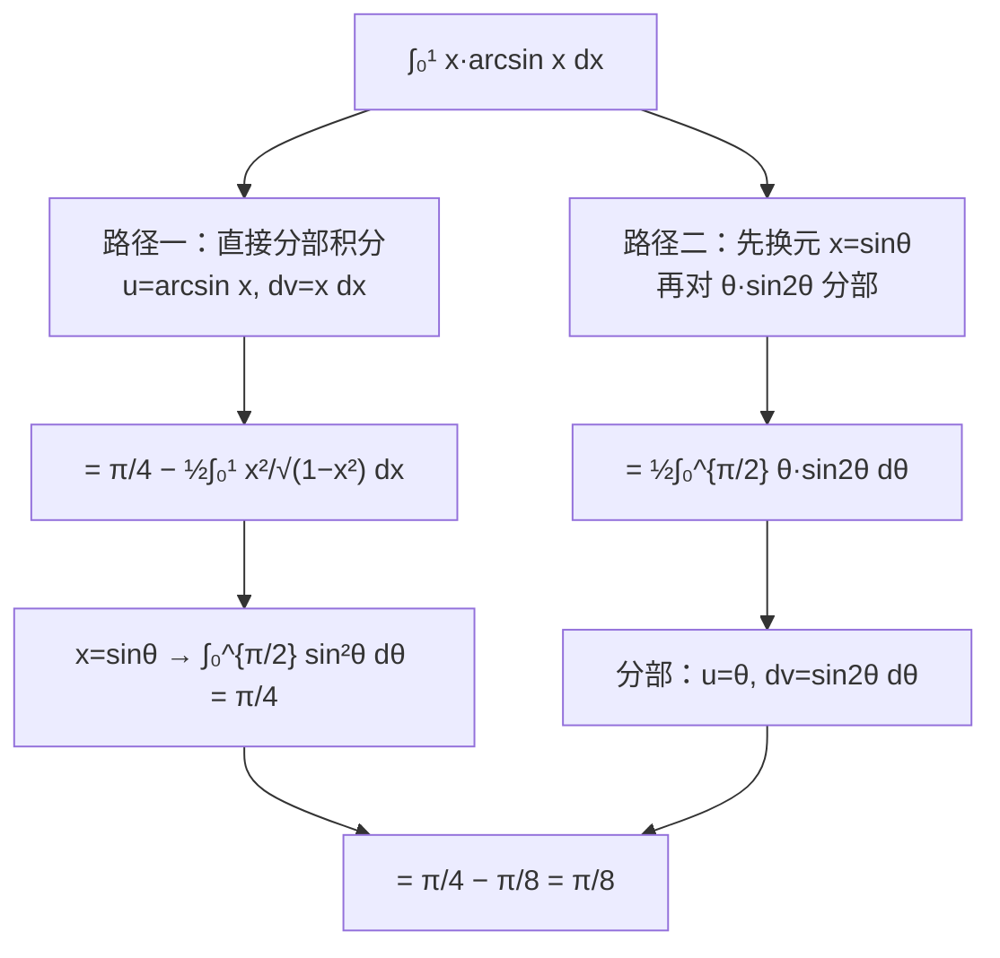

# 定积分 $\int_0^1 x\arcsin x\,dx$ 错题

## 错题信息

- 科目：高等数学
- 知识点：分部积分法（反三角函数与幂函数乘积）
- 题目来源：错题截图
- 我的答案：未作答
- 正确答案：$\dfrac{\pi}{8}$

## 题目

计算定积分 $\displaystyle\int_0^1 x\arcsin x\,\mathrm{d}x$。

## 参考解答

### 一、分部积分法（主解）

取 $u=\arcsin x$，$\mathrm{d}v=x\,\mathrm{d}x$，则 $\mathrm{d}u=\dfrac{1}{\sqrt{1-x^{2}}}\mathrm{d}x$，$v=\dfrac{x^{2}}{2}$。

$$I=\left[\frac{x^{2}}{2}\arcsin x\right]_{0}^{1}-\int_{0}^{1}\frac{x^{2}}{2\sqrt{1-x^{2}}}\,\mathrm{d}x=\frac{\pi}{4}-\frac{1}{2}J$$

其中 $J=\displaystyle\int_{0}^{1}\frac{x^{2}}{\sqrt{1-x^{2}}}\mathrm{d}x$。令 $x=\sin\theta$，$\mathrm{d}x=\cos\theta\,\mathrm{d}\theta$，$x\in[0,1]$ 对应 $\theta\in\left[0,\frac{\pi}{2}\right]$：

$$J=\int_{0}^{\frac{\pi}{2}}\frac{\sin^{2}\theta}{\cos\theta}\cos\theta\,\mathrm{d}\theta=\int_{0}^{\frac{\pi}{2}}\sin^{2}\theta\,\mathrm{d}\theta=\frac{\pi}{4}$$

所以

$$I=\frac{\pi}{4}-\frac{1}{2}\cdot\frac{\pi}{4}=\frac{\pi}{4}-\frac{\pi}{8}=\frac{\pi}{8}$$

### 二、换元法（先换元后分部）

令 $x=\sin\theta$，$\mathrm{d}x=\cos\theta\,\mathrm{d}\theta$：

$$I=\int_{0}^{\frac{\pi}{2}}\sin\theta\cdot\theta\cdot\cos\theta\,\mathrm{d}\theta=\frac{1}{2}\int_{0}^{\frac{\pi}{2}}\theta\sin2\theta\,\mathrm{d}\theta$$

分部积分：取 $u=\theta$，$\mathrm{d}v=\sin2\theta\,\mathrm{d}\theta$，则 $v=-\dfrac{\cos2\theta}{2}$：

$$\int_{0}^{\frac{\pi}{2}}\theta\sin2\theta\,\mathrm{d}\theta=\left[-\frac{\theta\cos2\theta}{2}\right]_{0}^{\frac{\pi}{2}}+\frac{1}{2}\int_{0}^{\frac{\pi}{2}}\cos2\theta\,\mathrm{d}\theta=-\frac{\pi}{2}\cdot\frac{\cos\pi}{2}+0=\frac{\pi}{4}$$

故 $I=\dfrac{1}{2}\cdot\dfrac{\pi}{4}=\dfrac{\pi}{8}$。

### 三、凑微分 + 直接求原函数

$$\int x\arcsin x\,\mathrm{d}x=\left(\frac{x^{2}}{2}-\frac{1}{4}\right)\arcsin x+\frac{x}{4}\sqrt{1-x^{2}}+C$$

代入上下限：$F(1)=\left(\dfrac{1}{2}-\dfrac{1}{4}\right)\cdot\dfrac{\pi}{2}+0=\dfrac{\pi}{8}$，$F(0)=0$，故 $I=\dfrac{\pi}{8}$。

## 根因分析

未作答，属首次接触此题型。常见错误：

1. **分部积分选 $u,v$ 反向**：取 $u=x$、$\mathrm{d}v=\arcsin x\,\mathrm{d}x$ 会让积分变成 $\int v\,\mathrm{d}u$ 时出现 $\sqrt{1-x^2}$ 的复杂结构，反而更难。
2. **忘记 $\arcsin x$ 的导数**：$\dfrac{\mathrm{d}}{\mathrm{d}x}\arcsin x=\dfrac{1}{\sqrt{1-x^{2}}}$，符号为正，易与 $\arccos$ 的负号混淆。
3. **$J$ 的三角换元处理不当**：$x=\sin\theta$ 后 $\sqrt{1-x^{2}}=\cos\theta$（在 $\left[0,\frac{\pi}{2}\right]$ 上取正），上下限要同步换成 $\left[0,\frac{\pi}{2}\right]$。
4. **漏算限值**：$\left[\frac{x^{2}}{2}\arcsin x\right]_{0}^{1}$ 中的 $\arcsin 1=\frac{\pi}{2}$，代入得 $\frac{\pi}{4}$ 而非 $\frac{\pi}{2}$。

## 完整知识点梳理

**「反三角函数 × 幂函数」的分部积分模板**：

| 被积函数形式 | 取 $u$ | 取 $\mathrm{d}v$ | 理由 |
| --- | --- | --- | --- |
| $x^{n}\arcsin x$ | $\arcsin x$ | $x^{n}\mathrm{d}x$ | 反三角求导变代数式，幂函数好积 |
| $x^{n}\arctan x$ | $\arctan x$ | $x^{n}\mathrm{d}x$ | 同上 |
| $x^{n}\ln x$ | $\ln x$ | $x^{n}\mathrm{d}x$ | 对数求导变有理式 |
| $x^{n}\sin x$ | $x^{n}$ | $\sin x\,\mathrm{d}x$ | 幂函数求导降次 |

**口诀：LIATE 选 $u$**（Logarithm 对数 > Inverse trig 反三角 > Algebraic 代数 > Trig 三角 > Exponential 指数），越靠前越适合做 $u$。

**关键公式**：

$$\frac{\mathrm{d}}{\mathrm{d}x}\arcsin x=\frac{1}{\sqrt{1-x^{2}}},\qquad \frac{\mathrm{d}}{\mathrm{d}x}\arccos x=-\frac{1}{\sqrt{1-x^{2}}}$$

$$\int_{0}^{\frac{\pi}{2}}\sin^{2}\theta\,\mathrm{d}\theta=\int_{0}^{\frac{\pi}{2}}\cos^{2}\theta\,\mathrm{d}\theta=\frac{\pi}{4}$$

**降幂公式推导**（知识点补充）：由二倍角公式 $\cos2\theta=1-2\sin^{2}\theta$ 移项得 $\sin^{2}\theta=\dfrac{1-\cos2\theta}{2}$，于是

$$\int_{0}^{\frac{\pi}{2}}\sin^{2}\theta\,\mathrm{d}\theta=\int_{0}^{\frac{\pi}{2}}\frac{1-\cos2\theta}{2}\,\mathrm{d}\theta=\left[\frac{\theta}{2}-\frac{\sin2\theta}{4}\right]_{0}^{\frac{\pi}{2}}=\frac{\pi}{4}-0=\frac{\pi}{4}$$

同理 $\cos^{2}\theta=\dfrac{1+\cos2\theta}{2}$，$\displaystyle\int_{0}^{\frac{\pi}{2}}\cos^{2}\theta\,\mathrm{d}\theta=\dfrac{\pi}{4}$。推广到完整周期区间：$\displaystyle\int_{0}^{\pi}\sin^{2}x\,\mathrm{d}x=\dfrac{\pi}{2}$、$\displaystyle\int_{0}^{\pi}\cos^{2}x\,\mathrm{d}x=\dfrac{\pi}{2}$。

**思路图例**（Mermaid，两条解法路径）：

**记忆口诀**：

> **「反三角优先当 $u$，幂函数塞进 $\mathrm{d}v$；换元记得换上下限，$\sin^2$ 积分是 $\pi/4$。」**

## 复刷清单

### 举一反三 5 题（双端同步）

1. $\displaystyle\int_0^1 x\arcsin x\,\mathrm{d}x$ 的值是多少？
2. 计算 $\displaystyle\int x\arctan x\,\mathrm{d}x$ 时应取哪个为 $u$？
3. $\displaystyle\int_0^1\frac{x^2}{\sqrt{1-x^2}}\mathrm{d}x$ 的值是多少？
4. $\arcsin x$ 的导数是什么？
5. 计算 $\displaystyle\int x\ln x\,\mathrm{d}x$ 的分部积分应如何选取 $u,\mathrm{d}v$？

### 历年真题风格练习（双端同步）

1. 【真题风格】计算 $\displaystyle\int_0^1 x\arccos x\,\mathrm{d}x$。
2. 【真题改编】计算 $\displaystyle\int_0^{\frac{\pi}{2}}\theta\sin\theta\,\mathrm{d}\theta$。
3. 【真题改编】已知 $\displaystyle\int_0^1 x\arcsin x\,\mathrm{d}x=\frac{\pi}{8}$，求 $\displaystyle\int_0^1 x\arccos x\,\mathrm{d}x$。

## 复习记录

- 2026-11-18：用户发送题目截图（未作答），按规则直接收录为错题；quiz 5 道复刷 + 3 道真题风格，艾宾浩斯第 1 轮 5 题，次日（2026-11-19）到期。
- 代数验证（Node）：解析值 $\pi/8\approx0.3926990817$；Simpson 数值积分 10 万区间得 $0.3926990853$，误差 $3.6\times10^{-9}$，一致。原函数 $F(x)=\left(\frac{x^{2}}{2}-\frac{1}{4}\right)\arcsin x+\frac{x}{4}\sqrt{1-x^{2}}$ 满足 $F(1)-F(0)=\pi/8$（精确一致），且数值微分与原被积函数最大误差 $1.1\times10^{-10}$，三重验证通过。
- 大模型二次验证：调用 `deepseek-v4-pro` API 逐题独立作答，8 题全部返回 A，与本地答案完全一致（1.A 2.A 3.A 4.A 5.A 6.A 7.A 8.A），无分歧。
