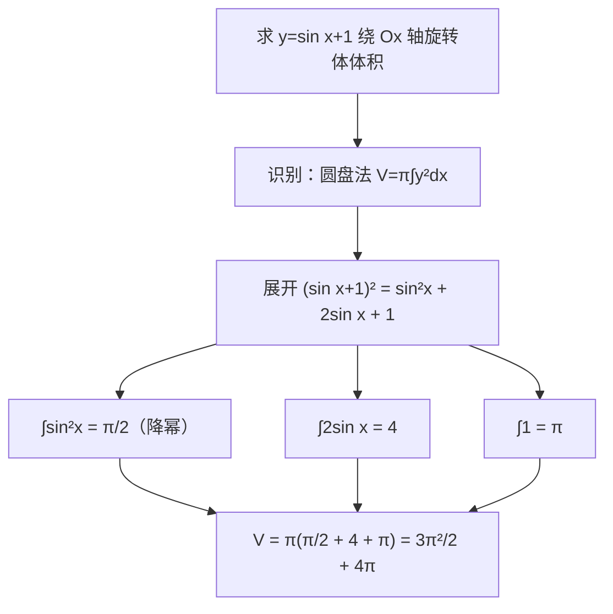

# 旋转体体积：$y=\sin x+1$ 绕 $Ox$ 轴错题

## 错题信息

- 科目：高等数学
- 知识点：旋转体体积（圆盘法）
- 题目来源：错题截图
- 我的答案：未作答
- 正确答案：$V=\dfrac{3\pi^{2}}{2}+4\pi\approx 27.37$

## 题目

设 $D$ 是由曲线 $y=\sin x+1$ 与三条直线 $x=0$，$x=\pi$，$y=0$ 围成的曲边梯形，求 $D$ 绕 $Ox$ 轴旋转一周所生成的旋转体的体积。

## 参考解答

### 圆盘法（主解）

绕 $Ox$ 轴旋转，体积公式为 $V=\pi\displaystyle\int_a^b y^{2}\,\mathrm{d}x$。

$$V=\pi\int_{0}^{\pi}(\sin x+1)^{2}\,\mathrm{d}x$$

展开被积函数：

$$(\sin x+1)^{2}=\sin^{2}x+2\sin x+1$$

分别计算三项（区间 $[0,\pi]$）：

| 项 | 计算 | 结果 |
| --- | --- | --- |
| $\displaystyle\int_{0}^{\pi}\sin^{2}x\,\mathrm{d}x$ | 降幂 $\sin^{2}x=\frac{1-\cos 2x}{2}$ | $\dfrac{\pi}{2}$ |
| $\displaystyle\int_{0}^{\pi}2\sin x\,\mathrm{d}x$ | $\left[-2\cos x\right]_{0}^{\pi}=2+2$ | $4$ |
| $\displaystyle\int_{0}^{\pi}1\,\mathrm{d}x$ | 直接积分 | $\pi$ |

合计：

$$V=\pi\left(\frac{\pi}{2}+4+\pi\right)=\pi\left(\frac{3\pi}{2}+4\right)=\frac{3\pi^{2}}{2}+4\pi$$

数值近似：$V\approx 27.37$。

## 根因分析

未作答，属首次接触此题型。常见错误：

1. **公式记错**：绕 $Ox$ 轴用圆盘法 $V=\pi\int y^{2}\mathrm{d}x$，不要漏掉外面的 $\pi$ 或写成 $\int y\,\mathrm{d}x$。
2. **忘记展开平方**：$(\sin x+1)^{2}$ 不是 $\sin^{2}x+1$，必须用完全平方公式展开成三项。
3. **$\sin^{2}x$ 降幂不熟**：$\sin^{2}x=\dfrac{1-\cos 2x}{2}$，在 $[0,\pi]$ 上积分为 $\dfrac{\pi}{2}$（不是 $\pi$）。
4. **$\sin x$ 积分符号错**：$\displaystyle\int_{0}^{\pi}\sin x\,\mathrm{d}x=\left[-\cos x\right]_{0}^{\pi}=2$，不是 $0$（$\cos\pi=-1$，$\cos 0=1$）。

## 完整知识点梳理

**旋转体体积公式**：

| 旋转轴 | 公式 | 适用场景 |
| --- | --- | --- |
| $Ox$ 轴（圆盘法） | $V=\pi\displaystyle\int_a^b y^{2}\,\mathrm{d}x$ | 曲线 $y=f(x)$ 与 $x$ 轴围成 |
| $Oy$ 轴（圆盘法） | $V=\pi\displaystyle\int_c^d x^{2}\,\mathrm{d}y$ | 曲线 $x=g(y)$ 与 $y$ 轴围成 |
| $Oy$ 轴（柱壳法） | $V=2\pi\displaystyle\int_a^b x\cdot y\,\mathrm{d}x$ | 绕 $y$ 轴，$x>0$ |
| 两曲线之间 | $V=\pi\displaystyle\int_a^b\left[y_{1}^{2}-y_{2}^{2}\right]\mathrm{d}x$ | $y_1$ 为外径，$y_2$ 为内径 |

### 四类公式的三维示意图与详细推导

四个公式都由**微元法**得到：先取一个薄片，算出它的体积微元 $\mathrm{d}V$，再沿轴积分。关键是认清「垂直于旋转轴的截面是什么形状」。

#### ① 绕 $Ox$ 轴（圆盘法） $V=\pi\displaystyle\int_a^b f^{2}(x)\,\mathrm{d}x$

**三维示意图**：


```fig3d
{"type":"discX","a":0,"b":3.141592653589793,"f":"x=>1+Math.sin(x)","seg":40,"lat":12,"yaw":-0.62,"pitch":0.42}
```


**推导**：

1. 在 $[a,b]$ 内任取 $x$，取宽为 $\mathrm{d}x$ 的一薄片；它绕 $Ox$ 轴旋转后是一个**实心圆盘**（圆柱薄片）。
2. 圆盘半径就是该处曲线高度 $r=f(x)$，故截面积 $A(x)=\pi r^{2}=\pi f^{2}(x)$。
3. 体积微元 $\mathrm{d}V=A(x)\,\mathrm{d}x=\pi f^{2}(x)\,\mathrm{d}x$。
4. 沿 $x$ 累加（积分）：$V=\displaystyle\int_a^b\mathrm{d}V=\pi\int_a^b f^{2}(x)\,\mathrm{d}x$。

> **易错点**：是 $f^{2}(x)$ 而不是 $f(x)$——体积来自「面积 × 厚度」，而圆面积含半径平方；写成 $\pi\int f\,\mathrm{d}x$ 就退化成了面积量纲。

#### ② 绕 $Oy$ 轴（圆盘法） $V=\pi\displaystyle\int_c^d g^{2}(y)\,\mathrm{d}y$

**三维示意图**：


```fig3d
{"type":"discY","a":0,"b":3.141592653589793,"g":"y=>0.5+0.4*Math.cos(y)","seg":40,"lat":12,"yaw":-0.85,"pitch":0.35,"ox":-40}
```


**推导**：

1. 曲线写成 $x=g(y)$（$y\in[c,d]$），在高度 $y$ 处取厚 $\mathrm{d}y$ 的**水平**薄片。
2. 该薄片绕 $Oy$ 轴旋转成圆盘，半径就是该处的横坐标 $r=g(y)$，截面积 $A(y)=\pi g^{2}(y)$。
3. 体积微元 $\mathrm{d}V=\pi g^{2}(y)\,\mathrm{d}y$。
4. 沿 $y$ 累加：$V=\pi\displaystyle\int_c^d g^{2}(y)\,\mathrm{d}y$。

> **易错点**：积分变量换成 $y$，上下限必须是 $y$ 的范围 $[c,d]$，不能再套 $[a,b]$；此时「半径」是横向距离 $x$，不是纵向高度。

#### ③ 绕 $Oy$ 轴（柱壳法） $V=2\pi\displaystyle\int_a^b x\,f(x)\,\mathrm{d}x$

**三维示意图**：


```fig3d
{"type":"shell","a":0,"b":3.141592653589793,"f":"x=>1+Math.sin(x)","shellX":1.9,"seg":40,"lat":12,"yaw":-0.5,"pitch":0.5}
```


**推导**：

1. 在 $x$ 处取宽 $\mathrm{d}x$、高 $f(x)$ 的**竖直**窄条，绕 $Oy$ 轴旋转成一个薄圆柱壳。
2. 壳的半径为 $x$，故周长为 $2\pi x$；壳高为 $f(x)$；壳厚为 $\mathrm{d}x$。
3. 把壳沿母线剪开摊平，近似为长方体：体积 $=$ 周长 $\times$ 高 $\times$ 厚，即 $\mathrm{d}V=2\pi x\cdot f(x)\,\mathrm{d}x$。
4. 沿 $x$ 累加：$V=2\pi\displaystyle\int_a^b x f(x)\,\mathrm{d}x$。

> **与 ② 的关系**：两者算的是同一个旋转体，只是切法不同（② 水平切圆盘、③ 竖直切柱壳）。当 $x=g(y)$ 的反函数难求时，用柱壳法直接对 $x$ 积分更省事。

#### ④ 两曲线之间（垫圈法） $V=\pi\displaystyle\int_a^b\left[y_{1}^{2}-y_{2}^{2}\right]\mathrm{d}x$

**三维示意图**：


```fig3d
{"type":"washer","a":0,"b":3.141592653589793,"y1":"x=>1+0.6*Math.sin(x)","y2":"x=>0.3+0.2*Math.sin(x)","seg":40,"lat":12,"yaw":-0.62,"pitch":0.42}
```


**推导**：

1. 设 $y_1=f(x)\ge y_2=g(x)\ge 0$，区域在两曲线之间，绕 $Ox$ 轴旋转。
2. 在 $x$ 处取宽 $\mathrm{d}x$ 的薄片，截面是**圆环（垫圈）**：外半径 $y_1$、内半径 $y_2$。
3. 环面积 $A(x)=\pi y_{1}^{2}-\pi y_{2}^{2}=\pi\left(y_{1}^{2}-y_{2}^{2}\right)$，故 $\mathrm{d}V=\pi\left(y_{1}^{2}-y_{2}^{2}\right)\mathrm{d}x$。
4. 沿 $x$ 累加：$V=\pi\displaystyle\int_a^b\left[y_{1}^{2}-y_{2}^{2}\right]\mathrm{d}x$。

> **易错点**：**不能**写成 $\pi\int (y_1-y_2)^{2}\mathrm{d}x$，因为 $(y_1-y_2)^2=y_1^2-2y_1y_2+y_2^2\ne y_1^2-y_2^2$；几何上这是「先相减再平方」，而正确的是「各自平方再相减」。


**关键积分结论**（区间 $[0,\pi]$）：

$$\int_{0}^{\pi}\sin^{2}x\,\mathrm{d}x=\frac{\pi}{2},\qquad \int_{0}^{\pi}\sin x\,\mathrm{d}x=2,\qquad \int_{0}^{\pi}\mathrm{d}x=\pi$$

**思路图例**（Mermaid）：



**三维示意图**（圆盘法 · 母线绕 $Ox$ 轴旋转）：

```svg
<svg viewBox="0 0 920 470" xmlns="http://www.w3.org/2000/svg" font-family="system-ui, sans-serif">
  <defs>
    <linearGradient id="solidGrad" x1="0" y1="0" x2="0" y2="1">
      <stop offset="0" stop-color="#60a5fa" stop-opacity="0.30"/>
      <stop offset="0.5" stop-color="#3b82f6" stop-opacity="0.14"/>
      <stop offset="1" stop-color="#60a5fa" stop-opacity="0.30"/>
    </linearGradient>
  </defs>
  <!-- 旋转体轮廓（上边界=曲线，下边界=镜像） -->
  <path d="M 130.0 297.0 L 140.7 303.5 L 151.3 309.9 L 162.0 316.2 L 172.7 322.2 L 183.3 328.0 L 194.0 333.4 L 204.7 338.5 L 215.3 343.1 L 226.0 347.2 L 236.7 350.7 L 247.3 353.6 L 258.0 356.0 L 268.7 357.6 L 279.3 358.7 L 290.0 359.0 L 300.7 358.7 L 311.3 357.6 L 322.0 356.0 L 332.7 353.6 L 343.3 350.7 L 354.0 347.2 L 364.7 343.1 L 375.3 338.5 L 386.0 333.4 L 396.7 328.0 L 407.3 322.2 L 418.0 316.2 L 428.7 309.9 L 439.3 303.5 L 450.0 297.0 L 460.7 290.5 L 471.3 284.1 L 482.0 277.8 L 492.7 271.8 L 503.3 266.0 L 514.0 260.6 L 524.7 255.5 L 535.3 250.9 L 546.0 246.8 L 556.7 243.3 L 567.3 240.4 L 578.0 238.0 L 588.7 236.4 L 599.3 235.3 L 610.0 235.0 L 620.7 235.3 L 631.3 236.4 L 642.0 238.0 L 652.7 240.4 L 663.3 243.3 L 674.0 246.8 L 684.7 250.9 L 695.3 255.5 L 706.0 260.6 L 716.7 266.0 L 727.3 271.8 L 738.0 277.8 L 748.7 284.1 L 759.3 290.5 L 770.0 297.0 L 770 235 L 130 235 Z" fill="url(#solidGrad)" stroke="none"/>
  <path d="M 130.0 173.0 L 140.7 166.5 L 151.3 160.1 L 162.0 153.8 L 172.7 147.8 L 183.3 142.0 L 194.0 136.6 L 204.7 131.5 L 215.3 126.9 L 226.0 122.8 L 236.7 119.3 L 247.3 116.4 L 258.0 114.0 L 268.7 112.4 L 279.3 111.3 L 290.0 111.0 L 300.7 111.3 L 311.3 112.4 L 322.0 114.0 L 332.7 116.4 L 343.3 119.3 L 354.0 122.8 L 364.7 126.9 L 375.3 131.5 L 386.0 136.6 L 396.7 142.0 L 407.3 147.8 L 418.0 153.8 L 428.7 160.1 L 439.3 166.5 L 450.0 173.0 L 460.7 179.5 L 471.3 185.9 L 482.0 192.2 L 492.7 198.2 L 503.3 204.0 L 514.0 209.4 L 524.7 214.5 L 535.3 219.1 L 546.0 223.2 L 556.7 226.7 L 567.3 229.6 L 578.0 232.0 L 588.7 233.6 L 599.3 234.7 L 610.0 235.0 L 620.7 234.7 L 631.3 233.6 L 642.0 232.0 L 652.7 229.6 L 663.3 226.7 L 674.0 223.2 L 684.7 219.1 L 695.3 214.5 L 706.0 209.4 L 716.7 204.0 L 727.3 198.2 L 738.0 192.2 L 748.7 185.9 L 759.3 179.5 L 770.0 173.0" fill="none" stroke="#3b82f6" stroke-width="2.6"/>
  <path d="M 130 235 L 130.0 297.0 L 140.7 303.5 L 151.3 309.9 L 162.0 316.2 L 172.7 322.2 L 183.3 328.0 L 194.0 333.4 L 204.7 338.5 L 215.3 343.1 L 226.0 347.2 L 236.7 350.7 L 247.3 353.6 L 258.0 356.0 L 268.7 357.6 L 279.3 358.7 L 290.0 359.0 L 300.7 358.7 L 311.3 357.6 L 322.0 356.0 L 332.7 353.6 L 343.3 350.7 L 354.0 347.2 L 364.7 343.1 L 375.3 338.5 L 386.0 333.4 L 396.7 328.0 L 407.3 322.2 L 418.0 316.2 L 428.7 309.9 L 439.3 303.5 L 450.0 297.0 L 460.7 290.5 L 471.3 284.1 L 482.0 277.8 L 492.7 271.8 L 503.3 266.0 L 514.0 260.6 L 524.7 255.5 L 535.3 250.9 L 546.0 246.8 L 556.7 243.3 L 567.3 240.4 L 578.0 238.0 L 588.7 236.4 L 599.3 235.3 L 610.0 235.0 L 620.7 235.3 L 631.3 236.4 L 642.0 238.0 L 652.7 240.4 L 663.3 243.3 L 674.0 246.8 L 684.7 250.9 L 695.3 255.5 L 706.0 260.6 L 716.7 266.0 L 727.3 271.8 L 738.0 277.8 L 748.7 284.1 L 759.3 290.5 L 770.0 297.0 L 770 235 L 130 235 Z" fill="none" stroke="#3b82f6" stroke-width="2" opacity="0.85"/>
  <!-- 圆盘截面（圆盘法微元） -->
  <ellipse cx="130.0" cy="235" rx="15" ry="62.0" fill="rgba(96,165,250,0.18)" stroke="#60a5fa" stroke-width="1.2"/>
    <ellipse cx="210.0" cy="235" rx="15" ry="105.8" fill="rgba(96,165,250,0.18)" stroke="#60a5fa" stroke-width="1.2"/>
    <ellipse cx="290.0" cy="235" rx="15" ry="124.0" fill="rgba(96,165,250,0.18)" stroke="#60a5fa" stroke-width="1.2"/>
    <ellipse cx="370.0" cy="235" rx="15" ry="105.8" fill="rgba(96,165,250,0.18)" stroke="#60a5fa" stroke-width="1.2"/>
    <ellipse cx="450.0" cy="235" rx="15" ry="62.0" fill="rgba(96,165,250,0.18)" stroke="#60a5fa" stroke-width="1.2"/>
    <ellipse cx="530.0" cy="235" rx="15" ry="18.2" fill="rgba(96,165,250,0.18)" stroke="#60a5fa" stroke-width="1.2"/>
    <ellipse cx="610.0" cy="235" rx="15" ry="0.0" fill="rgba(96,165,250,0.18)" stroke="#60a5fa" stroke-width="1.2"/>
    <ellipse cx="690.0" cy="235" rx="15" ry="18.2" fill="rgba(96,165,250,0.18)" stroke="#60a5fa" stroke-width="1.2"/>
    <ellipse cx="770.0" cy="235" rx="15" ry="62.0" fill="rgba(96,165,250,0.18)" stroke="#60a5fa" stroke-width="1.2"/>
  <!-- 旋转轴 Ox -->
  <line x1="80" y1="235" x2="850" y2="235" stroke="#94a3b8" stroke-width="1.6"/>
  <polygon points="850,235 840,230 840,240" fill="#94a3b8"/>
  <text x="860" y="240" fill="#94a3b8" font-size="15" font-weight="600">x</text>
  <text x="70" y="227" fill="#94a3b8" font-size="14">O</text>
  <!-- 半径标注 r = sin x + 1 在 x=π/2 -->
  <line x1="450.0" y1="235" x2="450.0" y2="173.0" stroke="#fbbf24" stroke-width="1.6" stroke-dasharray="4 3"/>
  <text x="462" y="211" fill="#fbbf24" font-size="14" font-weight="600">r = sin x + 1</text>
  <text x="444" y="161" fill="#e2e8f0" font-size="14" font-weight="700">y = sin x + 1</text>
  <!-- 圆盘微元标注 -->
  <line x1="629.2" y1="236.1" x2="721.2" y2="288.1" stroke="#4ade80" stroke-width="1.3"/>
  <text x="725.2" y="298.1" fill="#4ade80" font-size="13.5" font-weight="600">圆盘微元：dV = πr² dx</text>
  <text x="280" y="417" fill="#4ade80" font-size="13.5" font-weight="600">截面圆盘（半径随 x 变化）</text>
  <line x1="290.0" y1="367" x2="290.0" y2="401" stroke="#4ade80" stroke-width="1.3"/>
  <!-- 区间刻度 -->
  <text x="126" y="259" fill="#64748b" font-size="14" text-anchor="middle">0</text>
  <text x="450.0" y="259" fill="#64748b" font-size="14" text-anchor="middle">π/2</text>
  <text x="774" y="259" fill="#64748b" font-size="14" text-anchor="middle">π</text>
  <line x1="130" y1="229" x2="130" y2="241" stroke="#94a3b8"/>
  <line x1="770" y1="229" x2="770" y2="241" stroke="#94a3b8"/>
  <!-- 标题 -->
  <text x="460" y="440" fill="#e2e8f0" font-size="15.5" font-weight="700" text-anchor="middle">y = sin x + 1 绕 Ox 轴旋转体（[0, π]）· 圆盘法三维示意图</text>
</svg>
```

> 图中蓝色区域为旋转体实心部分，竖向椭圆为圆盘法微元截面（半径 $r=sin x+1$ 随 $x$ 变化），黄色虚线标注最大半径处 $x=pi/2$。体积即所有圆盘微元 $mathrm{d}V=pi r^{2},mathrm{d}x$ 沿 $[0,pi]$ 累加。

**记忆口诀**：

> **「绕轴平方再乘 $\pi$，完全平方先展开；$\sin^{2}$ 降幂得 $\pi/2$，$\sin$ 积分上下限差是 2。」**

## 复刷清单

### 举一反三 5 题（双端同步）

1. $y=\sin x+1$ 在 $[0,\pi]$ 上绕 $Ox$ 轴旋转的体积公式是？
2. $\displaystyle\int_{0}^{\pi}\sin^{2}x\,\mathrm{d}x$ 的值？
3. $\displaystyle\int_{0}^{\pi}\sin x\,\mathrm{d}x$ 的值？
4. 计算 $\displaystyle\int_{0}^{\pi}(\sin x+1)^{2}\,\mathrm{d}x$ 应先做什么？
5. 本题最终体积的解析式？

### 历年真题风格练习（双端同步）

1. 【真题风格】求 $y=\cos x+1$ 在 $\left[-\frac{\pi}{2},\frac{\pi}{2}\right]$ 上绕 $Ox$ 轴的旋转体体积。
2. 【真题改编】求 $y=2$ 与 $y=0$、$x\in[0,3]$ 围成图形绕 $Ox$ 轴的旋转体体积。
3. 【真题改编】求 $y=\sin x$ 与 $y=0$、$x\in[0,\pi]$ 围成图形绕 $Ox$ 轴的旋转体体积。

## 复习记录

- 2026-11-18：用户发送题目截图（未作答），按规则直接收录为错题；quiz 5 道复刷 + 3 道真题风格，艾宾浩斯第 1 轮 5 题，次日（2026-11-19）到期。
- 代数验证（Node）：Simpson 数值积分 $\displaystyle\int_{0}^{\pi}(\sin x+1)^{2}\mathrm{d}x$ 得 $8.7123889804$，与解析值 $\frac{3\pi}{2}+4=8.7123889804$ 完全一致（误差 $<10^{-8}$）；$V=\pi\times$ 该值 $=27.3707772160$，与 $\frac{3\pi^{2}}{2}+4\pi$ 一致。$\int_{0}^{\pi}\sin^{2}x\,\mathrm{d}x$ 中点法独立验证 $=1.5707963268=\frac{\pi}{2}$；被积函数在 $[0,\pi]$ 上最小值为 $1>0$，无奇点。
- 出题自查修正：真题风格第 1 题（$y=\cos x+1$ 在 $\left[-\frac{\pi}{2},\frac{\pi}{2}\right]$）初稿解析有误，经 Simpson 数值验证 $\int_{-\pi/2}^{\pi/2}(\cos x+1)^2\mathrm{d}x=\frac{3\pi}{2}+4$，$V=\frac{3\pi^{2}}{2}+4\pi$，已修正题面选项与解析。
- 大模型二次验证：调用 `deepseek-v4-pro` API 逐题独立作答，8 题全部返回 A，与本地代数结果完全一致，无分歧。
