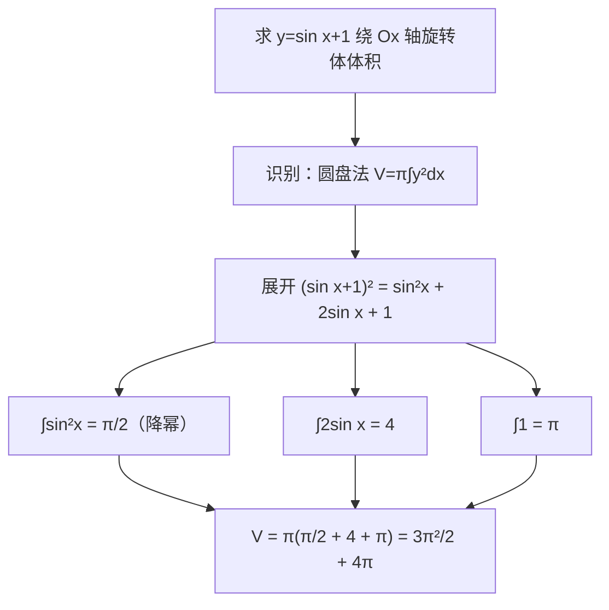

# 旋转体体积：$y=\sin x+1$ 绕 $Ox$ 轴错题

## 错题信息

- 科目：高等数学
- 知识点：旋转体体积（圆盘法）
- 题目来源：错题截图
- 我的答案：未作答
- 正确答案：$V=\dfrac{3\pi^{2}}{2}+4\pi\approx 27.37$

## 题目

设 $D$ 是由曲线 $y=\sin x+1$ 与三条直线 $x=0$，$x=\pi$，$y=0$ 围成的曲边梯形，求 $D$ 绕 $Ox$ 轴旋转一周所生成的旋转体的体积。

## 参考解答

### 圆盘法（主解）

绕 $Ox$ 轴旋转，体积公式为 $V=\pi\displaystyle\int_a^b y^{2}\,\mathrm{d}x$。

$$V=\pi\int_{0}^{\pi}(\sin x+1)^{2}\,\mathrm{d}x$$

展开被积函数：

$$(\sin x+1)^{2}=\sin^{2}x+2\sin x+1$$

分别计算三项（区间 $[0,\pi]$）：

| 项 | 计算 | 结果 |
| --- | --- | --- |
| $\displaystyle\int_{0}^{\pi}\sin^{2}x\,\mathrm{d}x$ | 降幂 $\sin^{2}x=\frac{1-\cos 2x}{2}$ | $\dfrac{\pi}{2}$ |
| $\displaystyle\int_{0}^{\pi}2\sin x\,\mathrm{d}x$ | $\left[-2\cos x\right]_{0}^{\pi}=2+2$ | $4$ |
| $\displaystyle\int_{0}^{\pi}1\,\mathrm{d}x$ | 直接积分 | $\pi$ |

合计：

$$V=\pi\left(\frac{\pi}{2}+4+\pi\right)=\pi\left(\frac{3\pi}{2}+4\right)=\frac{3\pi^{2}}{2}+4\pi$$

数值近似：$V\approx 27.37$。

## 根因分析

未作答，属首次接触此题型。常见错误：

1. **公式记错**：绕 $Ox$ 轴用圆盘法 $V=\pi\int y^{2}\mathrm{d}x$，不要漏掉外面的 $\pi$ 或写成 $\int y\,\mathrm{d}x$。
2. **忘记展开平方**：$(\sin x+1)^{2}$ 不是 $\sin^{2}x+1$，必须用完全平方公式展开成三项。
3. **$\sin^{2}x$ 降幂不熟**：$\sin^{2}x=\dfrac{1-\cos 2x}{2}$，在 $[0,\pi]$ 上积分为 $\dfrac{\pi}{2}$（不是 $\pi$）。
4. **$\sin x$ 积分符号错**：$\displaystyle\int_{0}^{\pi}\sin x\,\mathrm{d}x=\left[-\cos x\right]_{0}^{\pi}=2$，不是 $0$（$\cos\pi=-1$，$\cos 0=1$）。

## 完整知识点梳理

**旋转体体积公式**：

| 旋转轴 | 公式 | 适用场景 |
| --- | --- | --- |
| $Ox$ 轴（圆盘法） | $V=\pi\displaystyle\int_a^b y^{2}\,\mathrm{d}x$ | 曲线 $y=f(x)$ 与 $x$ 轴围成 |
| $Oy$ 轴（圆盘法） | $V=\pi\displaystyle\int_c^d x^{2}\,\mathrm{d}y$ | 曲线 $x=g(y)$ 与 $y$ 轴围成 |
| $Oy$ 轴（柱壳法） | $V=2\pi\displaystyle\int_a^b x\cdot y\,\mathrm{d}x$ | 绕 $y$ 轴，$x>0$ |
| 两曲线之间 | $V=\pi\displaystyle\int_a^b\left[y_{1}^{2}-y_{2}^{2}\right]\mathrm{d}x$ | $y_1$ 为外径，$y_2$ 为内径 |

**关键积分结论**（区间 $[0,\pi]$）：

$$\int_{0}^{\pi}\sin^{2}x\,\mathrm{d}x=\frac{\pi}{2},\qquad \int_{0}^{\pi}\sin x\,\mathrm{d}x=2,\qquad \int_{0}^{\pi}\mathrm{d}x=\pi$$

**思路图例**（Mermaid）：

**记忆口诀**：

> **「绕轴平方再乘 $\pi$，完全平方先展开；$\sin^{2}$ 降幂得 $\pi/2$，$\sin$ 积分上下限差是 2。」**

## 复刷清单

### 举一反三 5 题（双端同步）

1. $y=\sin x+1$ 在 $[0,\pi]$ 上绕 $Ox$ 轴旋转的体积公式是？
2. $\displaystyle\int_{0}^{\pi}\sin^{2}x\,\mathrm{d}x$ 的值？
3. $\displaystyle\int_{0}^{\pi}\sin x\,\mathrm{d}x$ 的值？
4. 计算 $\displaystyle\int_{0}^{\pi}(\sin x+1)^{2}\,\mathrm{d}x$ 应先做什么？
5. 本题最终体积的解析式？

### 历年真题风格练习（双端同步）

1. 【真题风格】求 $y=\cos x+1$ 在 $\left[-\frac{\pi}{2},\frac{\pi}{2}\right]$ 上绕 $Ox$ 轴的旋转体体积。
2. 【真题改编】求 $y=2$ 与 $y=0$、$x\in[0,3]$ 围成图形绕 $Ox$ 轴的旋转体体积。
3. 【真题改编】求 $y=\sin x$ 与 $y=0$、$x\in[0,\pi]$ 围成图形绕 $Ox$ 轴的旋转体体积。

## 复习记录

- 2026-11-18：用户发送题目截图（未作答），按规则直接收录为错题；quiz 5 道复刷 + 3 道真题风格，艾宾浩斯第 1 轮 5 题，次日（2026-11-19）到期。
- 代数验证（Node）：Simpson 数值积分 $\displaystyle\int_{0}^{\pi}(\sin x+1)^{2}\mathrm{d}x$ 得 $8.7123889804$，与解析值 $\frac{3\pi}{2}+4=8.7123889804$ 完全一致（误差 $<10^{-8}$）；$V=\pi\times$ 该值 $=27.3707772160$，与 $\frac{3\pi^{2}}{2}+4\pi$ 一致。$\int_{0}^{\pi}\sin^{2}x\,\mathrm{d}x$ 中点法独立验证 $=1.5707963268=\frac{\pi}{2}$；被积函数在 $[0,\pi]$ 上最小值为 $1>0$，无奇点。
- 出题自查修正：真题风格第 1 题（$y=\cos x+1$ 在 $\left[-\frac{\pi}{2},\frac{\pi}{2}\right]$）初稿解析有误，经 Simpson 数值验证 $\int_{-\pi/2}^{\pi/2}(\cos x+1)^2\mathrm{d}x=\frac{3\pi}{2}+4$，$V=\frac{3\pi^{2}}{2}+4\pi$，已修正题面选项与解析。
- 大模型二次验证：调用 `deepseek-v4-pro` API 逐题独立作答，8 题全部返回 A，与本地代数结果完全一致，无分歧。
